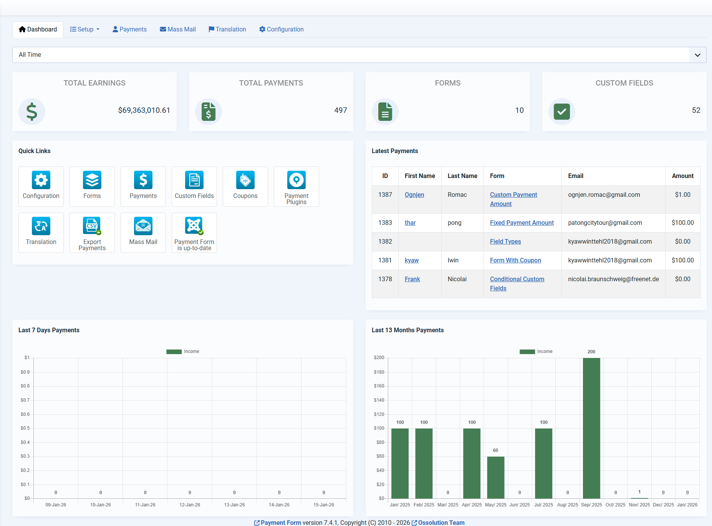
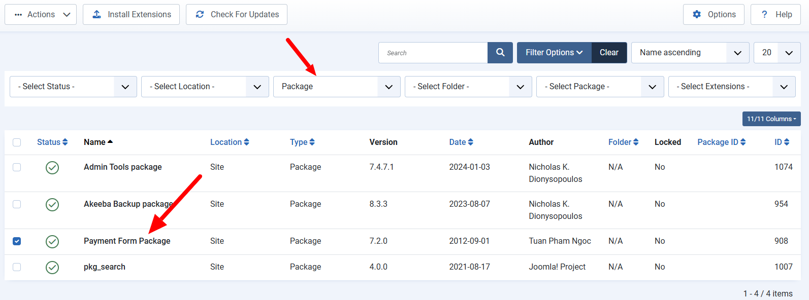

## Installation
When you purchase **Payment Form** extension from our site, you will receive an email contain the extension in a zip file called **payment_form_unzip_first.zip**. Unzip this file you will see a two zip files: **com_pmform.zip** and **plug_cb_pmhistory.zip**. Follow the instructions below and you will be able to install the extension easily:

### Install the component, modules and plugins

The component, all the modules and plugins are included in a single package com_pmform.zip
1. Login to back-end of your site using a super user account.
2. Access to **System -> Install -> Extensions**.
3. Browse for the file **com_pmform.zip**.
4. Click on **Upload & Install** button

After the installation process completed, you will be redirected to dashboard screen to start configuring and setting up the extension.

## Install the CB Payment History plugin
This plugin is a community builder plugin, not a Joomla plugin so it requires Community Builder extension to be installed on your site. If your site doesn't use Community Builder , don't install this plugin. Please note that Payment Form does not require Community Builder extension, so this plugin (and Community Builder) is optional.

1. Download the plugin [plug_cb_pmhistory.zip](plug_cb_pmhistory.zip)
2. Login to back-end of your site.
3. Access to **Components -> Community Builder -> Plugins Management** menu item
4. Click on **install plugin** link.
5. Browse for the **plug_cb_pmhistory.zip**
6. Click on **Upload and Install** button

## Install Sample Data

For new installation, you might want to setup sample data (the data uses on our demo site) to check and understand how certain things are setup. If you want that, login to administrator area of your site and access to this URL

**https://domain.com/administrator/index.php?option=com_pmform&task=tool.setup_sample_data**

Replace https://domain.com/administrator in the URL above with administrator URL of your site.

### Update
**Payment Form** allows you to use **Joomla Updater** to update the extension whenever there is new version release. To use **Joomla Update**, please follow the instructions below:

1. Go to [https://joomdonation.com/download-ids.html](https://joomdonation.com/download-ids.html), get **Download ID** of your account.
2. Then go to **Payment Form -> Configuration**, enter the received **Download ID** into **Download ID** config option.

From now on, each time there is new version of **Payment Form** release, Joomla will notify you about it when you access to backend of your site (or access to Payment Form dashboard). You just have to click on the link to update the extension from within your site, don't have to access to our site to download new version and update manually anymore, sweet :).

Please note that each site need to have an unique **Download ID** (the same **Download ID** however, **can be used for all our products**), so if you use the product on different websites, please make sure to generate new **Download ID** for each of these sites.

## Update Manually

Sometime, you might need to update to latest version manually (for example, when Joomla Updater doesn't work). In this case, please access to **My Downloads** menu item [https://joomdonation.com/my-downloads.html](https://joomdonation.com/my-downloads.html), download latest version of the extension from there. Then install that latest version in the same way as new installation.

## Move data from one site to a new site

Sometime, you have to move **Payment Form** data from one site to a new site. To do that, you will need to:

1. Export all **Payment Form** related database tables from old site via phpmyadmin (table with **_pf_** prefix)
2. Open that sql file, use find and replace function of the text editor to replace table prefix so that it meets the table prefix of the new site (in case your old site and new site use different database table prefix)
3. Import these database tables into new site database (via phpmyadmin)
4. Re-Install latest version of Payment Form to the new site so that the database schema will be updated to latest version

## Uninstall
If you have to uninstall **Payment Form** for some reasons (for example, you want starts from scratch - or maybe after installing and using it, you realize that it doesn't meet your requirement), you can follow the instructions below to get the extension completely uninstalled:

1. Login to backend of your site using a super admin account
2. Access to **System -> Manage -> Extensions**.
3. Choose **Package** from **Select Type** filter dropdown
4. Look for **Payment Form Package**, check on the checkbox next to the item.
6. Press **Actions -> Uninstall** button in the toolbar.

When you do that, the whole Payment Form package (component, modules, plugins) will be uninstalled.

>>>>> When you uninstall **Payment Form**, the database tables related to the extension won't be uninstalled. By doing that, when you re-install the extension in the future, all the old data will be kept and still be available. If you want to completely removing it, please access to your site database via phpmyadmin, look at all the tables with prefix __pf__ and drop these tables