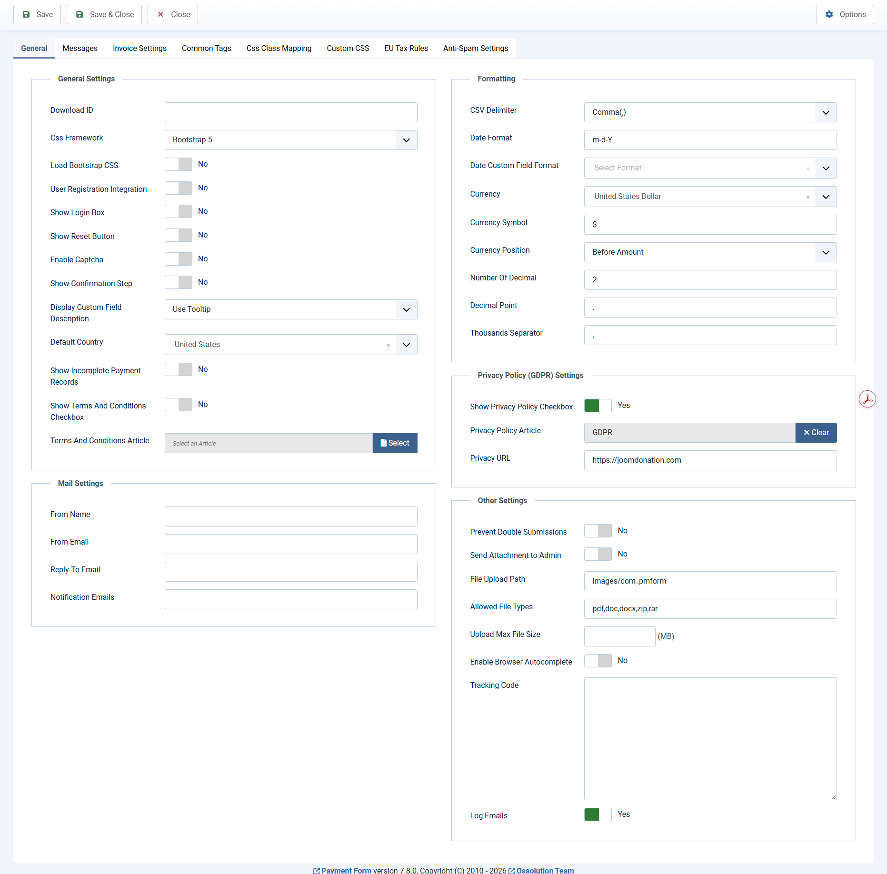

1. **Load Bootstrap CSS**: This should be set to **No** unless your site template is built base on a frontend framework not supported by Payment Form (**Twitter Bootstrap 4**, **Twitter Bootstrap 5** and **UIKIT3** are supported).
2. **Css Framework**: Default to **Bootstrap 5** because for Joomla 4 and Joomla 5, most of Joomla templates are built base on Twitter Bootstrap 5. If your site template is built base on **Bootstrap 4** or **UIKIT3**, set this config option to the appropriate value.
3. **User Registration Integration**: If set to Yes, when users access to a form to make payment, the system will allow them to enter username and password on to register for an account on your Joomla site.
4. **Only Create User Account For Success Payment**: By default, **Payment Form** will create an account for users right after they complete entering information on the form (before the payment is processed). If for some reasons, the payment is failed or the user abandon the payment, the account will remain blocked and he could not use that account again if he decides to pay again in the future. If you set this config option to **Yes**, **Payment Form** will only create the Joomla account for users when the payment record is Paid (after completing payment for or admin approves the payment), it will solve the issue mentioned above. Based on my experience, I would suggest to set this config option to **Yes**.
5. **Show Login Box**: If set to Yes, on form page, the system will display login box so that existing users can login before continuing the payment process. If you have **User registration integration** config option set to **Yes**, you should set this config option to **Yes**, too.
6. **Enable Captcha**: If you want to use Captcha on **Payment Form** to prevent spam, you need to set this config option to Yes. As **Payment Form** uses Joomla core captcha, beside setting this config option to Yes, you need to config Joomla core re-captcha plugin, too. Please see [https://docs.joomla.org/How_do_you_use_Recaptcha_in_Joomla%3F](https://docs.joomla.org/How_do_you_use_Recaptcha_in_Joomla%3F) for instructions.
7. **Date Format**: Enter the date format you want. It will be used to format the date displaying in the system. For list of supported parameters, please see [https://www.php.net/manual/en/datetime.format.php](https://www.php.net/manual/en/datetime.format.php). 
8. **Date Custom Field Format**: Payment Form allows you to create custom fields to collect more information of users on the form. If you use **Date** custom field, you should change this config option to have the format you want.
9. **Currency**: It is $ by default. If you use different currency, you can change the currency here to meet your own currency. You need to change Currency Symbol, too.
10. **Terms And Conditions Article**: If you need your users to accept your terms and conditions to make payment, please create a terms and conditions article, then select that article in the config option. When you select an article, the system will display a checkbox (has link to the selected article) and users will have to check on that checkbox to agree on terms and conditions to complete the subscription. Remember to check on **Show Terms And Conditions Checkbox** checkbox, too.

