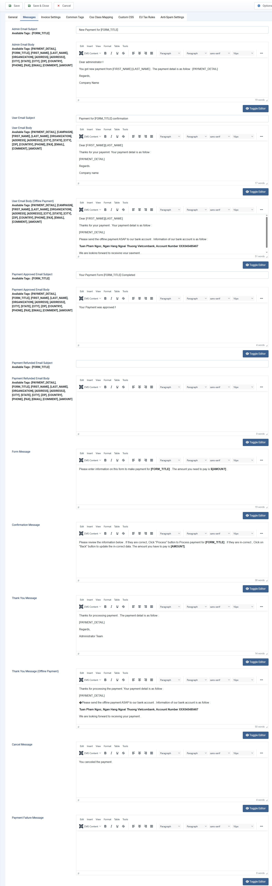

Use the **Messages** tab to edit the default email templates and the text customers see during payment. Set the sender and notification addresses in [General → Mail Settings](/getting-started/configuration/general#mail-settings).

## Payment emails

- **Admin Email Subject** and **Admin Email Body** control the notification sent to administrators after a completed payment or an offline submission.
- **User Email Subject** and **User Email Body** control the customer's confirmation email. **User Email Body (Offline Payment)** replaces the body for offline submissions. Use it to explain how to pay, for example by bank transfer.
- **Payment Approved Email Subject** and **Payment Approved Email Body** control the email sent when an administrator marks a pending payment as **Paid**, typically after receiving an offline payment. See [Approve Payments](/payments-management/approve-payments).
- **Payment Refunded Email Subject** and **Payment Refunded Email Body** control the email sent to the customer after a successful refund from the Payment Form administrator area. Leave the subject blank to skip the refund email. See [Refund Payment](/payments-management/refund-payment).

Use tags such as `[FORM_TITLE]` in an email subject and `[PAYMENT_DETAIL]` in an email body to insert details from the payment. To reuse values such as your company name across templates, see [Common Tags](/getting-started/configuration/common-tags).

## Messages on the website

- **Form Message** appears above the payment form.
- **Confirmation Message** appears above the payment summary when **Show Confirmation Step** is enabled.
- **Thank You Message** appears on Payment Form's completion page. **Thank You Message (Offline Payment)** appears after an offline submission. Include the payment instructions here so customers can see them immediately.
- **Cancel Message** and **Payment Failure Message** appear on Payment Form's cancellation and failure pages. Use these messages to tell customers what to do next.

## Messages for additional offline methods

If you publish additional offline payment plugins, the **Messages** tab shows a separate **User Email Body** and **Thank You Message** for each method. For example, you can give bank transfer customers different instructions from customers who pay in cash.

Payment Form uses the messages set on the individual form first, then the messages for the selected offline method, then the general offline defaults.

If a payment email is missing or contains unexpected text, check the [Emails Log](/payments-management/email-log).
