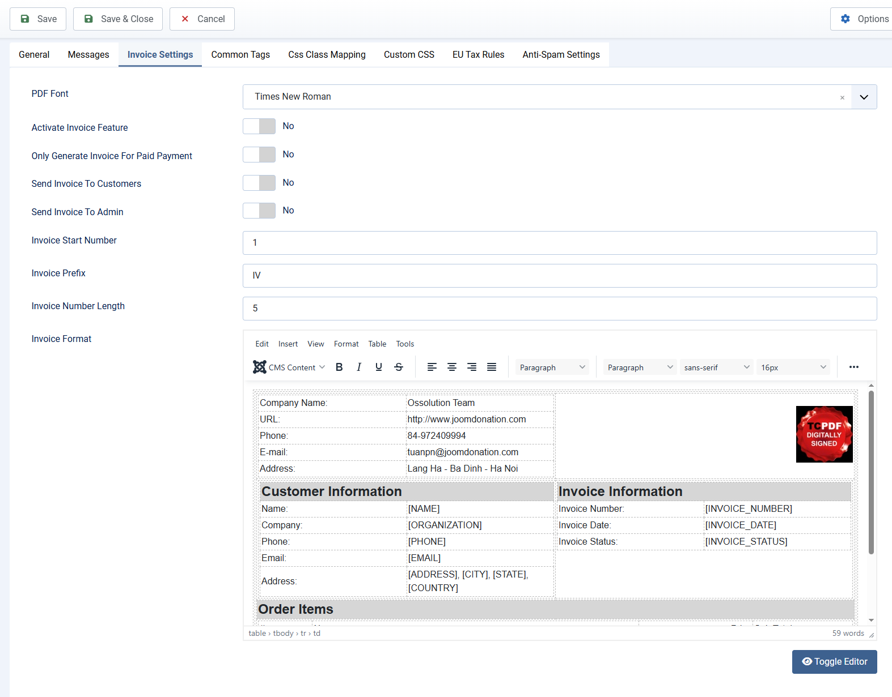

1. Set **Activate Invoice Feature** to **Yes** to generate PDF invoices for completed payments.
2. Set **Send invoice to customers** to **Yes** to attach the PDF invoice to the payment confirmation email. We recommend this setting if you use the invoice feature. If you select **No**, customers can download their invoices from the payment history page.
3. Use **Invoice Start Number** if you want invoice numbering to start at a number other than 1.
4. Review **Invoice Format** to customize the default invoice template. At a minimum, replace the invoice logo with your own.

