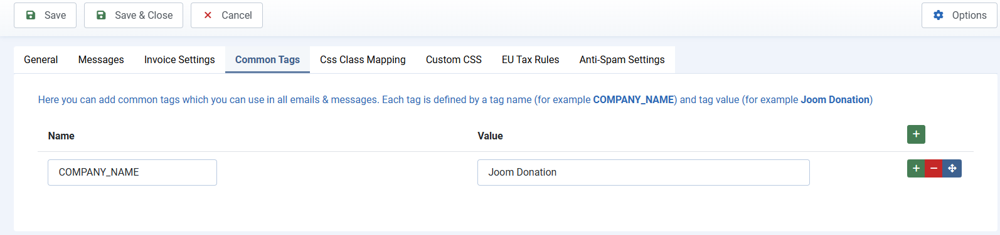

Use common tags to insert reusable values into Payment Form emails. For example, create a tag named `COMPANY_NAME` with the value `JoomDonation`. When you add `[COMPANY_NAME]` to an email template, Payment Form replaces the tag with `JoomDonation` when it sends the email.

