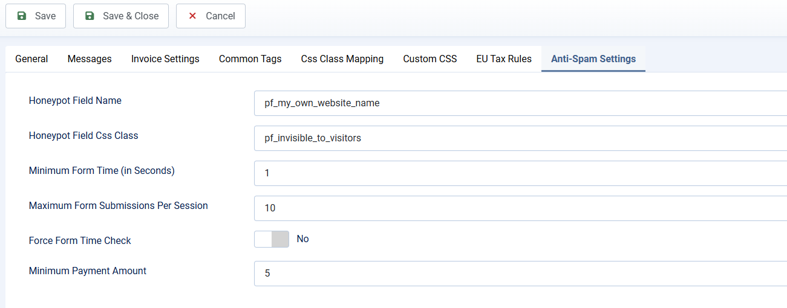

Payment Form includes built-in spam protection. Open the **Anti-Spam Settings** tab in **Configuration** to adjust these settings.

- **Honeypot Field Name** sets the name of the hidden field used to catch spam bots.
- **Honeypot Field Css Class** sets the CSS class for the honeypot field. We recommend keeping the default. If you use a class such as `my-custom-css-class`, add the following rule in the **Custom CSS** tab to hide the field from visitors.

    ```css
    .my-custom-css-class {
        display: none !important;
    }
    ```

- **Minimum Form Time (in Seconds)** sets how long visitors must wait before submitting a form. A minimum of 1 or 2 seconds can block automated submissions. Signed-in customers may also submit quickly if the form is prefilled from a previous submission. Leave this setting blank if you are unsure what minimum to use.
- **Maximum Form Submissions Per Session** limits how many times a visitor can submit the same form in one session. For example, set it to `10` to allow up to 10 submissions per session.
- **Minimum Payment Amount** blocks submissions below the amount you specify. For example, set it to `5` to block payments smaller than 5 in the form's currency.


