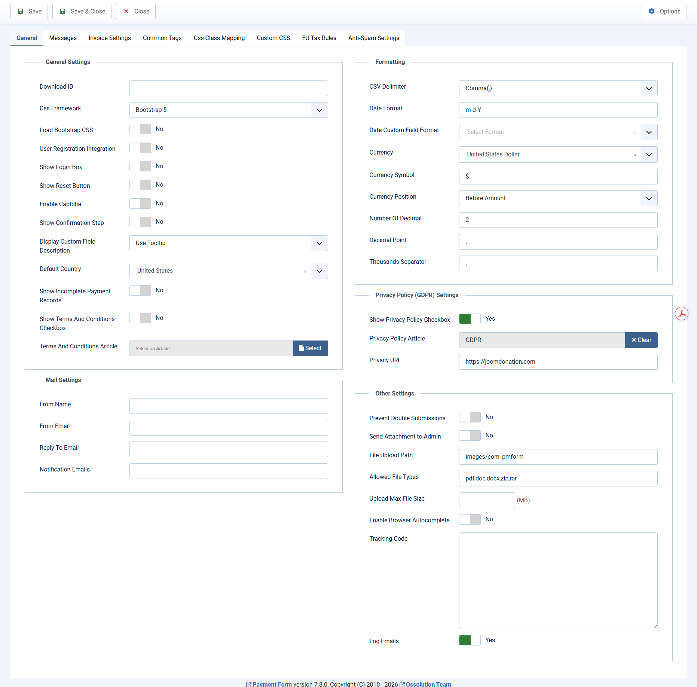

Payment Form applies default settings during installation. Review them and adjust them to suit your site.

Go to **Payment Form → Configuration** to view and change the settings.

>>>>> Hover over a setting's name to see its description.

The following pages explain the main configuration options. If you have questions about another setting, contact our support team.
