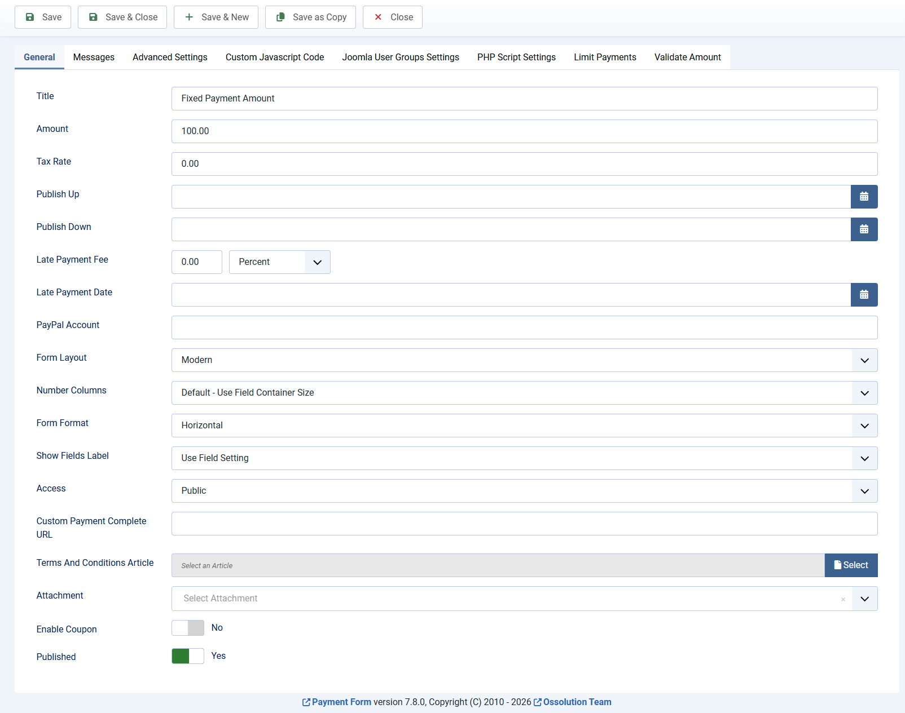

In the Joomla administrator area, go to **Components → Payment Form → Forms** and select **New**.

1. On **General**, enter a **Title** and set **Amount** to the base charge. Enter `0` if the form is free or if fields determine the full amount. See [Form Types](/basic-setup/forms/form-types) for examples of both setups.
2. Choose **Modern** under **Form Layout** to configure label placement and columns. Set **Access** to **Public** for a form open to everyone or **Registered** to require a Joomla login.
3. For a form that takes payments, select the methods you want to offer under **Advanced Settings → Payment Methods**. Configure and publish them first under [Payment Plugins](/basic-setup/payment-plugins).
4. Save the form, then go to **Custom Fields** to [assign and configure its fields](/basic-setup/forms/customize-form#choose-the-fields-to-display).

## General

| Setting | Description |
| --- | --- |
| **Title** | The name shown to payers, such as **Conference registration**. |
| **Amount** | The base charge in the form's currency. Custom fee fields can add to it. To accept a payer-entered amount with no base charge, set this to `0` and assign an [amount field](/basic-setup/forms/form-types/payer-entered-amount-form). |
| **Tax Rate** | Enter a fixed percentage for this form, such as `10` for 10%. When [EU Tax Rules](/basic-setup/eu-tax-rules) are enabled, they determine the tax and this setting is hidden. |
| **Publish Up** | The date and time when the published form opens. Leave blank to open the form as soon as it is published. |
| **Publish Down** | The date and time when the form closes. Leave blank to keep it open until you unpublish it. |
| **Late Payment Fee** | Choose **Percent** or **Fixed Amount**. A percentage applies to the base amount plus custom field fees, before coupons and tax. |
| **Late Payment Date** | Payments made after this date include the late fee. Leave blank to skip the late fee. |
| **PayPal Account** | Overrides the receiving account for the [PayPal Standard](/basic-setup/payment-plugins/paypal) payment plugin. Leave blank to use the account configured in that plugin. |
| **Form Layout** | Choose **Modern** for configurable columns and label placement. **Default**, **Inline**, **2 Columns 2 Lines**, **2 Columns Inline**, and any installed custom layouts are also available. |
| **Number Columns** | In **Modern**, choose **2**, **3**, or **4** for equal field widths, or **Default - Use Field Container Size** to set widths in the custom field editor. |
| **Form Format** | In **Modern**, choose **Horizontal** for labels beside inputs or **Stacked** for labels above inputs. See [Modern Form Layouts](/basic-setup/forms/modern-form-layouts) for examples. |
| **Show Fields Label** | Choose **Use Field Setting** to follow each custom field's **Show Field Label** setting. Choose **Yes** or **No** to set label visibility for the form's custom fields together. |
| **Access** | The Joomla viewing access level required to open and submit the form. |
| **Custom Payment Complete URL** | Sends the payer to your URL in place of Payment Form's built-in completion page. If you use it for an offline payment form, put the payment instructions on the destination page. |
| **Terms And Conditions Article** | Select a Joomla article for this form, or leave it blank to use the global article. Enable **Show Terms And Conditions Checkbox** in [Configuration](/getting-started/configuration/general#general-settings) to ask the payer to agree. |
| **Attachment** | Adds a file to the email sent to the payer. Place the file in `media/com_pmform` first, then select it here. The dropdown uses the allowed file types in Configuration. |
| **Enable Coupon** | Shows the coupon-code input. Create the codes the form should accept under [Coupons](/basic-setup/coupons). |
| **Published** | Set to **Yes** when the form is ready to accept submissions. The publish dates and access level still apply. |

## Messages

Use this tab to replace the [default messages and email templates](/getting-started/configuration/messages) for this form. Leave a field blank to use the configured default. For offline payments, a message set on the form takes precedence over instructions configured for the selected offline method.

| Setting | Description |
| --- | --- |
| **Form Message** | Appears above the form. You can use `[FORM_TITLE]` and `[AMOUNT]`. |
| **Confirmation Message** | Appears above the payment summary when **Show Confirmation Step** is enabled in Configuration. You can use `[FORM_TITLE]` and `[AMOUNT]`. |
| **Thank You Message** | Appears on the built-in completion page after an online payment or a free submission. |
| **Thank You Message (Offline Payment)** | Appears on the built-in completion page after an offline submission. Use it to tell the payer what to do next. |
| **Cancel Message** | Appears on the cancellation page. |
| **Admin Email Subject** | The subject of the notification sent to the form's notification email addresses. |
| **Admin Email Body** | The body of the payment notification sent to administrators. |
| **User Email Subject** | The subject of the payment email sent to the payer. |
| **User Email Body** | The body of the payer's confirmation email for an online payment or a free submission. |
| **User Email Body (Offline Payment)** | The body of the payer's confirmation email for an offline submission. Include instructions such as where to send a bank transfer and which reference to use. |

Use tags such as `[FORM_TITLE]` in an email subject or `[PAYMENT_DETAIL]` in an email body to insert payment information.

## Advanced Settings

| Setting | Description |
| --- | --- |
| **Notification Emails** | Comma-separated addresses that receive payment notifications for this form. Leave blank to use the global notification addresses. |
| **Payment Methods** | Select the published methods to offer on this form, or select **All Payment Methods** to allow all published methods available to the payer. When only one method is available, Payment Form selects it automatically. |
| **Currency** | The currency used for payments from this form. Select **Default** to use the global currency. Check that the selected gateway supports the currency you choose. |
| **Currency Symbol** | The symbol displayed for this form. Leave blank to use the global symbol. If you change **Currency**, update the symbol to match. |
| **User Registration Integration** | Choose whether guests enter Joomla account details as part of the form. Select **Use Global** to inherit the component setting. |
| **Show Login Box** | Displays a login box for existing users when **User Registration Integration** is enabled. Select **Use Global** to inherit the component setting. See [Registration and login](/basic-setup/forms/customize-form#registration-and-login). |
| **Invoice Format** | Overrides the global invoice template when [PDF invoices](/getting-started/configuration/invoice-settings) are enabled. Leave blank to use the global template. |

Some installations also show per-form credentials for Authorize.net or PayPal Standard Checkout. To offer the same gateway with different credentials on different forms, you can duplicate a [payment plugin](/basic-setup/payment-plugins), configure the copy, and select the appropriate instance in each form's **Payment Methods**.

## Custom JavaScript

Enter form-specific JavaScript in the **Custom Javascript Code** tab. Payment Form loads the code when it renders this form on the site.

## Translation and integration settings

When Joomla multilingual support is enabled, the **Translation** tab lets you translate the form title, messages, email subjects, and email bodies for each configured language.

Enabled Payment Form plugins can add tabs to the editor. For example, [Limit Payments](/plugins/payment-form-limit-payments) controls how many payments the form accepts, and [Validate Payment Amount](/plugins/validate-payment-amount) sets the allowed payment range for the form.
