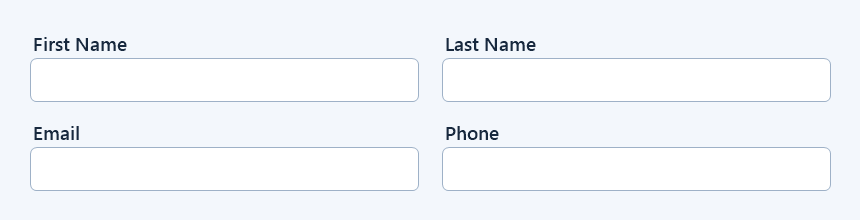
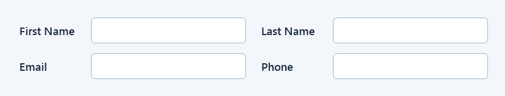
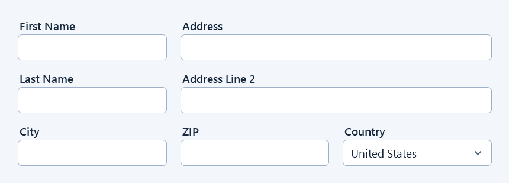
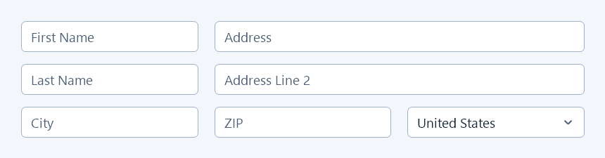

In Joomla, go to **Components → Payment Form → Forms**, open your form, and select **Modern** under **Form Layout** on the **General** tab.

Use **Form Format** to place each label beside its input (**Horizontal**) or above it (**Stacked**). Use **Number Columns** to control how many fields share a row. You can combine either label format with any column layout.

## Choose a layout

For the first five examples, set **Show Fields Label** to **Yes**. In the examples below, **Default** means **Default - Use Field Container Size** in the **Number Columns** list.

### One column with labels beside inputs

Set **Form Format** to **Horizontal** and **Number Columns** to **Default**. Edit each custom field and set **Container Size** to **Full Width**. Each field gets its own row, with the label on the left and the input beside it.

### One column with labels above inputs

Use the same full-width fields and change **Form Format** to **Stacked**. This puts each label directly above its input.

### Two columns with labels above inputs

Set **Number Columns** to **2** and **Form Format** to **Stacked**. The fields share each row equally, with each label above its input.

### Two columns with labels beside inputs

Keep **Number Columns** at **2** and change **Form Format** to **Horizontal**. Each row still has two fields, and each label sits beside its input.

### Custom grid with mixed field widths

Set **Number Columns** to **Default** and **Form Format** to **Stacked**. Edit each field's **Container Size** and arrange the fields in the order shown below. Choose widths that add up to a full row.

| Row | Fields in display order |
| --- | --- |
| 1 | First Name (**1/3**), Address (**2/3**) |
| 2 | Last Name (**1/3**), Address Line 2 (**2/3**) |
| 3 | City (**1/3**), ZIP (**1/3**), Country (**1/3**) |

### Custom grid with hidden labels

Keep the custom grid settings above and set **Show Fields Label** to **No**. The field widths stay the same. To show hints such as “First Name” and “Address” inside empty text inputs, enter them in the **Place Holder** setting for each field. The country dropdown in this example shows its selected value.

Placeholders disappear as users type. Keep visible labels where users need to refer back to them, or keep labels visible on selected fields with **Use Field Setting**.

## How the settings work together

- **Number Columns** set to **2**, **3**, or **4** gives each field an equal share of the row and overrides individual **Container Size** settings. Choose **Default - Use Field Container Size** to set widths field by field.
- **Container Size** is set in the custom field editor. The options are **Full Width**, **1/2**, **1/3**, **2/3**, **1/4**, **2/4**, and **3/4**. **1/2** and **2/4** use the same width.
- **Show Fields Label** set to **Yes** or **No** applies to all custom field labels. Choose **Use Field Setting** to follow the **Show Field Label** option in each field's settings.
- **Position** still controls where a field appears. Fields set to **Below Payment Amount** or **Below Payment Method** stay in their assigned sections and also use the width set by **Number Columns** when you choose **2**, **3**, or **4**.

If the published form looks different, check whether its Joomla menu item overrides **Number Columns**, **Form Format**, or **Show Fields Label**. The illustrations show the layouts on a wide screen. Preview your form on a phone too, since the site template and available space can affect how fields fit.
