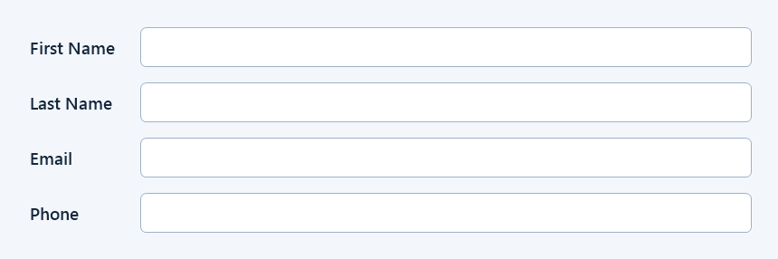
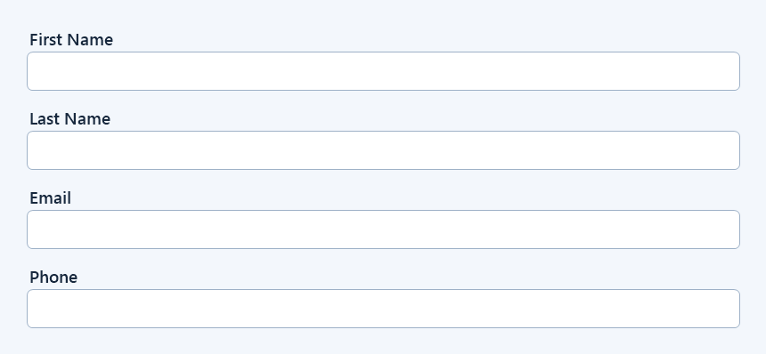

In the Joomla administrator area, open **Components → Payment Form → Forms**, select your form, and set **Form Layout** to **Modern** on the **General** tab. The layout uses the CSS framework selected in [Configuration](/getting-started/configuration/general#general-settings). Use the setting that matches your site template.

| What you want to change | Setting |
| --- | --- |
| Whether labels sit beside or above the inputs | Set **Form Format** to **Horizontal** or **Stacked**. |
| How many equal-width fields share a row | Set **Number Columns** to **2**, **3**, or **4**. This overrides each field's **Container Size**. |
| Separate widths for individual fields, including full-width rows | Set **Number Columns** to **Default - Use Field Container Size**, then set **Container Size** for each field under **Custom Fields → Display Settings**. |
| Which labels are visible | Set **Show Fields Label** to **Yes** or **No** for the entire form. To control labels individually, choose **Use Field Setting** and edit **Show Field Label** on the relevant fields. |

## Layout examples

The first five examples keep the labels visible. In these examples, **Default** is short for **Default - Use Field Container Size** in the **Number Columns** list.

### One column with labels beside inputs

Set **Form Format** to **Horizontal** and **Number Columns** to **Default**. Edit each custom field and set **Container Size** to **Full Width**. Each field gets its own row, with the label on the left and the input beside it.

### One column with labels above inputs

Use the same full-width fields and change **Form Format** to **Stacked**. This puts each label directly above its input.

### Two columns with labels above inputs

Set **Number Columns** to **2** and **Form Format** to **Stacked**. The fields share each row equally, with each label above its input.

### Two columns with labels beside inputs

Keep **Number Columns** at **2** and change **Form Format** to **Horizontal**. Each row still has two fields, and each label sits beside its input.

### Custom grid with mixed field widths

Set **Number Columns** to **Default** and **Form Format** to **Stacked**. In each field's **Display Settings**, set **Container Size** to the width shown below. Use the **Custom Fields** list to put the fields in display order. Choose widths that add up to a full row where you want the next field to start on a new row.

| Row | Fields in display order |
| --- | --- |
| 1 | First Name (**1/3**), Address (**2/3**) |
| 2 | Last Name (**1/3**), Address Line 2 (**2/3**) |
| 3 | City (**1/3**), ZIP (**1/3**), Country (**1/3**) |

### Custom grid with hidden labels

Keep the custom grid and set **Show Fields Label** to **No**. To show hints such as “First Name” and “Address” inside empty text inputs, enter the hint in the field's **Place Holder** setting. The country dropdown in this example shows its selected value.

Placeholders disappear as users type. Choose **Use Field Setting** to keep labels visible where users need them, especially on dropdowns, radio buttons, and checkbox groups where the options alone may leave the question unclear.

## Move fields within the form

In the custom field's **Display Settings**, use **Position** to move it from the main group of fields to **Below Payment Amount** or **Below Payment Method**. Keep fields that a visitor always needs to see in **Default**, since **Below Payment Amount** appears only when the form displays the amount section. The column settings apply to custom fields in these positions as well.

## Check Joomla menu item settings

If the form looks different on the site, check the Joomla menu item that [displays the form](/frontend-items/display-a-single-form). A **Form Modern Layout** menu item uses the Modern layout for that page and can override **Number Columns**, **Form Format**, and **Show Fields Label**. Select **Use Default** for these settings to inherit the values from the form. A **Form Default Layout** menu item follows the layout selected in the form editor.

Preview the same page on a phone and a desktop. The screenshots show the layout on a wide screen. How fields fit at smaller widths depends on your template and CSS framework.
