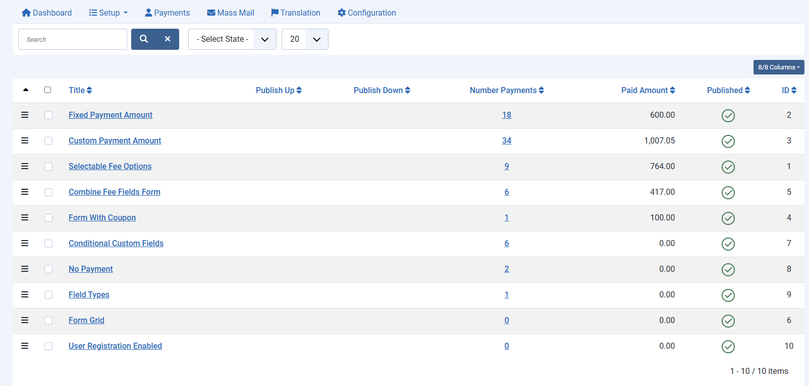

To access to forms management page, there are 3 different ways:

1. Access to **Components -> Payment Form -> Forms**
2. From Payment Form Dashboard, then click on **Forms** icon.
3. On any Payment Form pages, click on **Setup -> Forms** link sub-menu

From this page, you can see manage all forms created in the extension. Add new form, edit an existing form, publish/unpublish/delete the forms you want. For each form in the list, you can see number of payments/submissions, total received payment amount.

