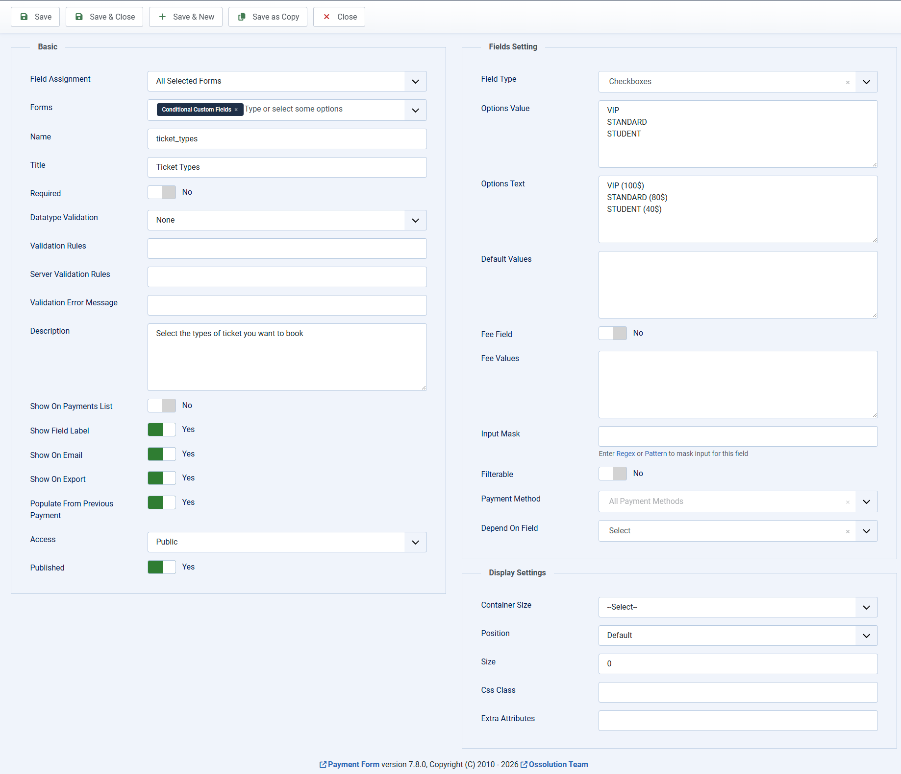

Open **Components → Payment Form → Custom Fields** and select **New**. The editor groups settings under **Basic**, **Field Settings**, and **Display Settings**. Some settings appear only for particular field types or when another setting is enabled. Save the field, then confirm that it is published and assigned to the intended form.

## Basic

- **Field Assignment**: Choose where this field is used:
  - **All Forms** applies it to every form.
  - **All Selected Forms** applies it only to forms selected under **Forms**.
  - **All Except Selected Forms** applies it to every form except those selected under **Forms**.
- **Forms**: Select one or more forms when using either selected-form assignment option. This control is hidden for **All Forms**.
- **Name**: The field's internal identifier, used when storing and referring to the value. Use a unique, simple name without spaces; for fee formulas, refer to a field by its name in uppercase inside square brackets, such as `[PF_QUANTITY]`.
- **Title**: The label shown for the field. When Joomla multilingual support is enabled, translated titles can be entered in the language tabs.
- **Required**: Choose whether the payer must provide a value. This does not apply to informational fields such as **Heading** and **Message**.
- **Datatype Validation**: Select a built-in validation type, such as Email, Number, Date, or a character or selection limit. The available choices are listed in the editor. Setting **None** disables this preset.
- **Validation Rules**: Client-side validation rules. The selected **Datatype Validation** can generate this value automatically. The interface advises leaving it unchanged unless you know the validation syntax.
- **Server Validation Rules**: Additional rules checked on the server. Configure these only if you know the supported rule syntax.
- **Validation Error Message**: The message displayed when validation fails.
- **Description**: Help text associated with the field. For **Message** fields, this description is the content displayed on the form.
- **Field Mapping**: Shown only when an installed Payment Form integration provides field mappings. Select the external field that should receive this value.
- **Show On Payments List**: Controls whether the field is shown as a column in the administrator's payments list.
- **Show Field Label**: Controls whether the label is displayed with the field on the form.
- **Show On Email**: Includes or omits the field value from payment emails.
- **Show On Export**: Includes or omits the field value from payment exports.
- **Populate From Previous Payment**: When enabled, pre-fills the field from the payer's previous payment where a previous value is available.
- **Access**: Choose the Joomla access level required to view the field.
- **Published**: Only published fields are available for use on forms.

## Field Settings

- **Field Type**: Choose the field's input or display type. Core fields have a fixed type. See [Supported field types](/basic-setup/custom-fields/field-types).
- **Allowed File Types**: Shown for **File** fields. Enter allowed extensions separated by commas, without dots, for example `zip,doc,pdf,docx`. The global upload size and storage location are configured in Payment Form settings.
- **Min** and **Max**: Shown for **Number** and **Range** fields. Set the lowest and highest permitted or selectable value.
- **Step**: Shown for **Number**, **Range**, and **Time** fields. Sets the increment between accepted or selectable values.
- **Receive Confirmation Email**: Shown for **Text** and **Email** fields. If the field contains a valid email address, Payment Form sends the payment email to that address as well as the payer's email address.
- **Multiple**: Shown for **List**. Set to **Yes** to allow more than one selection.
- **Options Value**: Shown for **List**, **Checkboxes**, and **Radio**. Enter the stored value for each option, one per line.
- **Options Text**: Shown for those same choice fields. Optionally enter the text displayed to the payer, one per line in the same order as **Options Value**. Leave blank to display the option values themselves.
- **Default Values**: Set the initial value or selection. For multiple choice defaults, enter each selected value on its own line. For an **SQL** field, enter the query here; it must return columns named `value` and `text`.
- **Fee Field**: Shown for **Text**, **Number**, **Range**, **Hidden**, **List**, **Checkboxes**, **Radio**, and **Date** fields. Set to **Yes** when this field should contribute a calculated fee to the total.
- **Fee Values**: Shown for **List**, **Checkboxes**, and **Radio**. Enter one numeric fee per option, on separate lines and in the same order as **Options Value**. See [Custom fee fields](/basic-setup/custom-fields/custom-fee-fields).
- **Fee Formula**: Shown when **Fee Field** is enabled for a supported type. Use `[FIELD_VALUE]`, arithmetic operators, and (when needed) other field values in square brackets. See [Custom fee fields](/basic-setup/custom-fields/custom-fee-fields) for examples and calculation details.
- **Input Mask**: Shown for **Text**, **Tel**, **Range**, and **Number**. Enter a mask using [IMask regular-expression syntax](https://imask.js.org/guide.html#masked-base) or [pattern syntax](https://imask.js.org/guide.html#masked-pattern). A mask guides the input format; use validation settings when you also need to enforce a value rule.
- **Filterable**: Shown for choice fields. When enabled, payment records can be filtered by this field's option values.
- **Payment Method**: Choose **All Payment Methods** to show the field for every payment method, or choose a specific method to limit when it is shown.
- **Depend On Field**: Optionally select a published **List**, **Checkboxes**, or **Radio** field to control when this field is shown.
- **Depend On Options**: After choosing a dependency field, select the option or options that make this field visible. See [Field dependencies](/basic-setup/custom-fields/field-dependencies).

## Display Settings

- **Container Size**: Choose the field's width in the form layout: full width, one-half, one-third, two-thirds, one-quarter, or three-quarters. Leave blank to use the layout default.
- **Position**: Choose where the field appears: **Default**, **Below Payment Amount**, or **Below Payment Methods**.
- **Rows** and **Cols**: Shown for **Textarea**. Set its visible height and width in rows and columns.
- **Size**: Shown for **Text**, **Tel**, **Number**, **Email**, **Checkboxes**, **Radio**, and **Time**. Sets the input's size attribute.
- **Max Length**: Shown for **Text**, **Tel**, **Number**, and **Textarea**. Limits the number of characters entered.
- **Css Class**: Add a CSS class for custom styling.
- **Place Holder**: Shown for **Text**, **Textarea**, **Url**, **Email**, **Number**, **Tel**, **Time**, and **Date**. Enter hint text displayed inside the empty input. When multilingual support is enabled, it can be translated in the language tabs.
- **Extra Attributes**: Add HTML attributes to the rendered input, such as `readonly`. Use valid attributes for the selected field type.