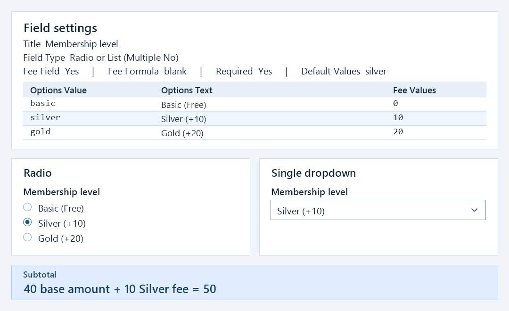
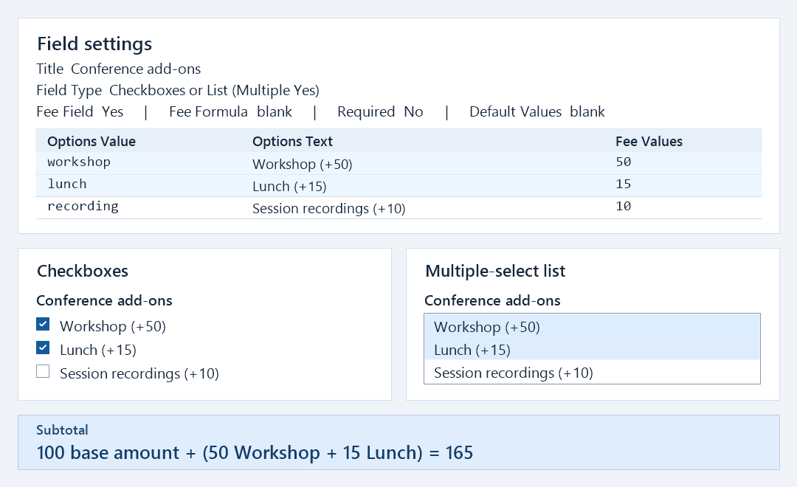

A custom fee field adds to the form's base **Amount** when a payer selects an option or enters a value. For example, a membership form can add a fee for a selected level, and a registration form can add fees for several optional extras.

Open **Components → Payment Form → Custom Fields** in Joomla. [Add a custom field](/basic-setup/custom-fields/add-new-custom-field) or edit an existing one, assign it to your form, and set **Fee Field** to **Yes**. This setting is available for **Text**, **Number**, **Range**, **Hidden**, **Date**, **List**, **Checkboxes**, and **Radio**.

Set the form's **Amount** to the base charge. Use `0` when all pricing comes from custom fee fields. The examples below use a fixed base amount and show subtotals before any late-payment fee, discount, tax, or payment-method fee.

## Charge for selected options

For **Radio**, **List**, and **Checkboxes**, enter one item per line in each of these three boxes. Keep the lines in the same order so each option gets its intended label and fee.

| Setting | What to enter |
| --- | --- |
| **Options Value** | The stored value, such as `silver`. Use it in **Default Values** to preselect that option. |
| **Options Text** | The label the payer sees, such as `Silver (+10)`. Include the price in the label if you want it displayed alongside the option. |
| **Fee Values** | The amount to add, such as `10`. Enter `0` for a free option and enter amounts without currency symbols. |

Leave **Fee Formula** empty for these examples so Payment Form uses **Fee Values**.

### One choice with Radio or a single dropdown

Create a field titled **Membership level**. Choose **Radio** to show all options at once, or choose **List** and set **Multiple** to **No** to show a dropdown. Set **Required** to **Yes** and enter `silver` in **Default Values** to preselect Silver.

| Line | Options Value | Options Text | Fee Values |
| --- | --- | --- | ---: |
| 1 | `basic` | Basic (Free) | `0` |
| 2 | `silver` | Silver (+10) | `10` |
| 3 | `gold` | Gold (+20) | `20` |

Set the form's **Amount** to `40`. With **Silver** selected, the field adds `10`, for a subtotal of **50**. Switching to **Gold** changes the field fee to `20`, for a subtotal of **60**.

### Multiple choices with Checkboxes or a multiple-select list

Create a field titled **Conference add-ons**. Choose **Checkboxes**, or choose **List** and set **Multiple** to **Yes**. Set **Required** to **No** and leave **Default Values** empty so the payer can skip the add-ons.

| Line | Options Value | Options Text | Fee Values |
| --- | --- | --- | ---: |
| 1 | `workshop` | Workshop (+50) | `50` |
| 2 | `lunch` | Lunch (+15) | `15` |
| 3 | `recording` | Session recordings (+10) | `10` |

Set the form's **Amount** to `100`. If the payer selects **Workshop** and **Lunch**, the field adds `50 + 15 = 65`, for a subtotal of **165**. With no add-ons selected, the subtotal is **100**.

## Charge based on a number the payer enters

Use a **Number** field for an amount or a quantity. For example, to let the payer enter an optional donation, create a **Donation Amount** field, set **Fee Field** to **Yes**, and enter `[FIELD_VALUE]` in **Fee Formula**. If the payer enters `10`, the field adds 10. Set the form's **Amount** to `0` if the donation is the only charge.

**Text**, **Number**, **Range**, and **Hidden** fee fields use `[FIELD_VALUE]` automatically when **Fee Formula** is empty.

## Calculate a fee with a formula

Use **Fee Formula** for pricing based on arithmetic. You can use `+`, `-`, `*`, `/`, and parentheses.

| Pricing rule | Fee Formula | Example |
| --- | --- | --- |
| Add a fixed charge | `5` | Adds 5. |
| Charge 20 per ticket entered in this field | `[FIELD_VALUE] * 20` | A quantity of 3 adds 60. |
| Charge 10% of the base amount | `[FORM_AMOUNT] * 0.10` | A base amount of 100 adds 10. |
| Charge 5% of the subtotal before percentage fees using `[PF_TOTAL_AMOUNT]` | `[PF_TOTAL_AMOUNT] * 0.05` | A subtotal of 100 adds 5. |

### Reference form amounts and field values

| Variable | Value used in the calculation |
| --- | --- |
| `[FIELD_VALUE]` | The current field's value converted to a number. For a single-choice field, this comes from the stored **Options Value**, so use a numeric option value if the formula relies on it. |
| `[FORM_AMOUNT]` | The base amount used for the payment before custom fees. |
| `[FIELD_NAME]` | A value from another field. Use its **Name** in uppercase. For example, `pf_quantity` becomes `[PF_QUANTITY]`. For numeric inputs this is the input value. For choices with fixed fees it is the mapped fee, or the sum of mapped fees for multiple selections. |
| `[PF_TOTAL_AMOUNT]` | The base amount plus all custom fees calculated before the separate pass for **Fee Formula** expressions that use this variable. Each of those expressions uses the same subtotal. |

### Calculate the fee for an individual option

You can also put a formula on a line in **Fee Values**. For example, if a **Number** field named `pf_quantity` collects the number of tickets, enter `[PF_QUANTITY] * 20` on the **Fee Values** line for **Standard ticket**. Selecting Standard ticket with a quantity of 3 adds 60. For a multiple-choice field, Payment Form evaluates the fee for each selected option and adds the results.

Use **Fee Formula** on a fee field for calculations that depend on `[PF_TOTAL_AMOUNT]`. Payment Form skips fields hidden by dependencies, calculates custom fees, then applies any late-payment fee, coupon discount, tax, and payment-method fee.
