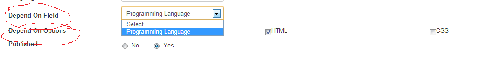
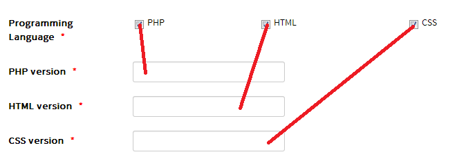

Field dependencies conditionally show additional fields based on a selection in another field. For example, you can ask for a software version only when the payer checks that they use the related programming language.

The field that controls visibility is the **master field**. It must be a published **List**, **Checkboxes**, or **Radio** field.

1. Edit or create the field that should appear conditionally.
2. Under **Depend On Field**, select the master field.
3. Under **Depend On Options**, select the option or options that should make this field visible.
4. Save the field and confirm that both fields are assigned to the intended form.

## Example: collect versions for selected languages

Create a **Checkboxes** master field titled **Programming Languages**, with the options **PHP**, **HTML**, and **CSS**. Then create three **Text** fields:

| Field | Depend On Field | Depend On Options |
| --- | --- | --- |
| PHP Version | Programming Languages | PHP |
| HTML Version | Programming Languages | HTML |
| CSS Version | Programming Languages | CSS |

On the form, each version field appears when its matching language is selected and is hidden when that option is cleared.

