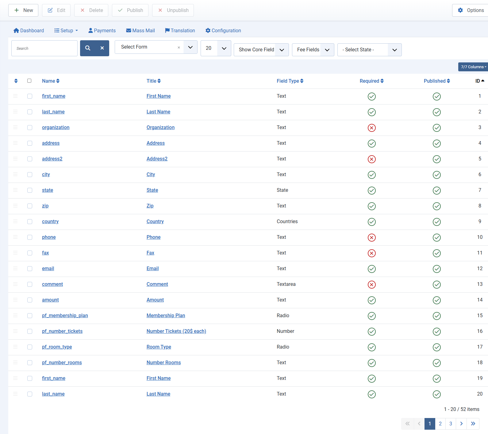

Custom fields collect information from people using a payment form. They can also control the amount charged, for example by letting someone choose an option with an added fee or enter an amount.

Payment Form creates a set of **core fields** when it is installed, including  **First Name**, **Last Name**, **Organization**, **Address**, **Address2**, **City**, **State**, **Zip**, **Country**, **Phone**, **Fax**, **Amount**, **Email**, **Comment**. You can edit these fields, but their field types are fixed. You can create additional custom fields for your forms.

## Open Custom Fields

In Joomla administrator, go to **Components → Payment Form → Custom Fields**. You can also open **Setup → Custom Fields** from another Payment Form page.

## Manage fields

- **Change a label or settings:** Open a field, edit its properties, and save.
- **Show or hide a field:** Publish or unpublish it. Check the field's form assignment as well, since a published field may be assigned only to selected forms.
- **Make a field required or optional:** Edit it and set **Required** to **Yes** or **No**.
- **Add a field:** Select **New**. See [Add a custom field](/basic-setup/custom-fields/add-new-custom-field).
- **Change the order:** Drag a field to its new position in the list.

Payment amounts can come from a fixed amount set on the form, an **Amount** field where the payer enters an amount, or fee fields that calculate additions from form input. Choose the setup that fits your payment flow; see [Custom fee fields](/basic-setup/custom-fields/custom-fee-fields) for calculated additions.