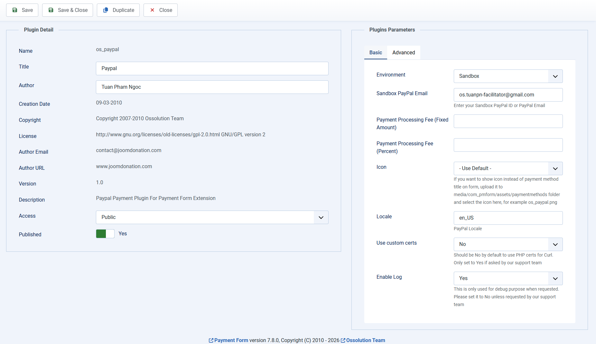
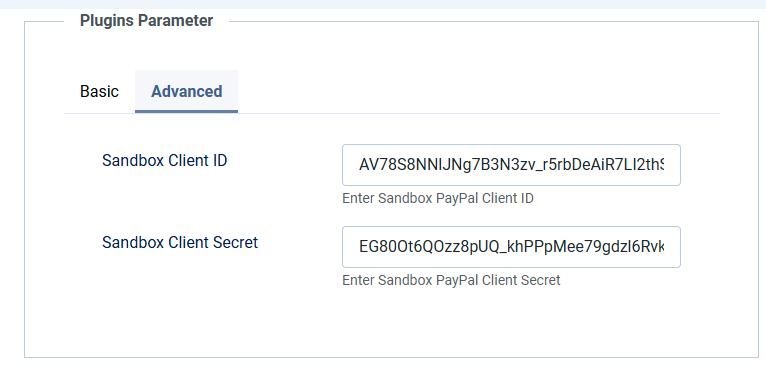

On Payment Plugins management screen, click on **os_paypal** payment plugin to edit it. The following parameters need to be configured:

## Basic
1. **Environment**: Set to **Sandbox** if you are testing the system and set it to **Live** when you go live. Please note that if you use **Sandbox**, you will need to register for a sandbox PayPal account (you could not use your real Paypal account in Test Mode)
2. **Paypal Email**: Enter the Paypal Email associated with your Paypal account.

## Advanced
If you have a business PayPal account, you can follow the instructions at [https://developer.paypal.com/api/rest/#link-getclientidandclientsecret](https://developer.paypal.com/api/rest/#link-getclientidandclientsecret) , get **Client ID**, **Client Secret** of from PayPal account, enter it into os_paypal payment plugin parameters (Advanced tab) to allow admin to refund for a payment record from administrator area of the site

