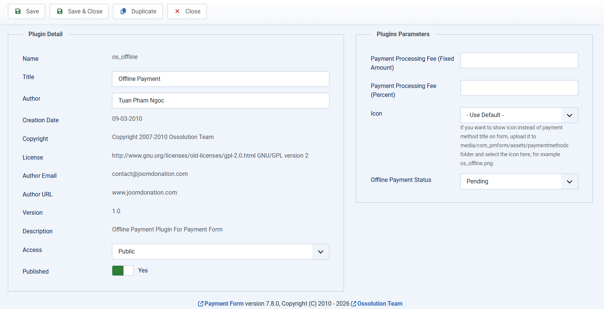

**Offline payment** plugin is a special payment plugin comes with the extension. It allows users to make payment for the form later (not at the time they enter data on the form) by bank transfer, by cash...

When users choose offline payment for the payment, the system will mark the payment status as **Pending**. It will also display a message which guide users how to make payment.... This guide will also be sent to them via email

After receiving payment from users for the payment, admin will login to backend of the site, click on the payment record, change the status from **Pending** to **Paid**.

If you use **Offline Payment** on your site, please go to **Payment Form** -> **Configuration**, look at Messages tab, find and change the following messages to meet your need (mostly guide users how to send payment to you)

1. **User email body (offline payment)**
2. **Thank you message (offline payment)**.

