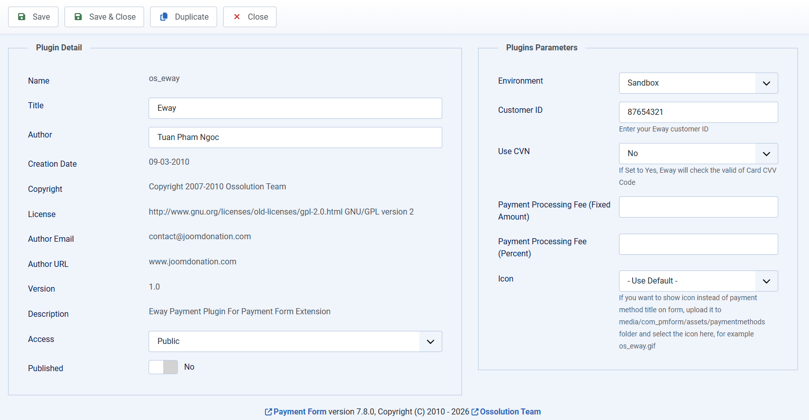

On Payment Plugins management screen, click on **os_eway** payment plugin to edit it. The following parameters need to be configured:

**1. Customer ID**: Get Customer ID from your Eway account and enter it into this parameter

