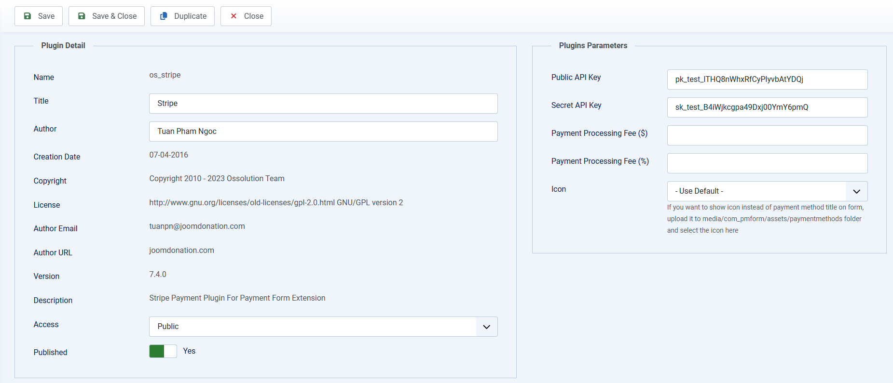

## Installation
When you purchase the payment plugin, you will receive a zip file called **os_pmf_stripe.zip**. Go to **Payment Form** -> **Payment Plugins** to install it as any other payment plugin. See [**Install Payment Plugin**](/basic-setup/payment-plugins#install-new-payment-plugin) for installation instructions if needed.

## Configuration
Click on the payment plugin to edit, enter payment plugin parameters, then publish it. You can follow instructions at https://stripe.com/docs/keys#api-keys to get API Keys from your Stripe account to enter into payment plugin parameters.

