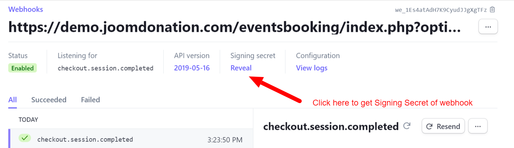

## Installation
Extract `os_pmf_stripecheckout_unzip_first.zip` and [install the plugin ZIP](/basic-setup/payment-plugins#install-new-payment-plugin) from inside it under **Payment Form → Payment Plugins**.

## Configuration

1. Enter your Stripe API keys in the payment plugin settings. [Stripe API keys](https://stripe.com/docs/keys#api-keys)

2. Follow instructions at [https://stripe.com/docs/webhooks/setup#add-endpoint-dashboard](https://stripe.com/docs/webhooks/setup#add-endpoint-dashboard), add the webhook URL below to your Stripe account:

**https://domain.com/index.php?option=com_pmform&task=payment_confirm&payment_method=os_stripecheckout**

(Of course, need to replace **https://domain.com/** with your website url)

Select the event **checkout.session.completed** for that webhook URL.

3. After setting up webhook, you need to get **Signing secret** of the webhook URL, and enter it into **Signing Secret** parameter of the payment plugin. In the webhook URL setting, click on Reveal button to get it (see the below screenshot)

