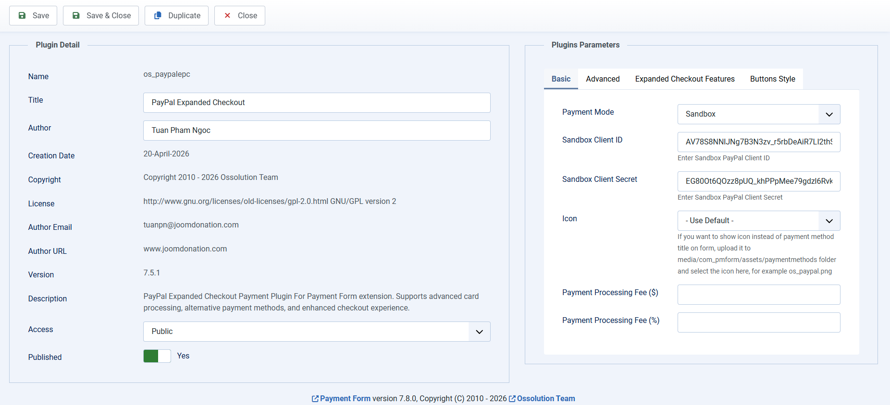

## Installation

When you purchase the payment plugin, you will receive a zip file called **os_pmf_paypalepc.zip**. Go to **Payment Form** -> **Payment Plugins** to install it as any other payment plugin. See [**Install Payment Plugin**](/basic-setup/payment-plugins#install-new-payment-plugin) for installation instructions if needed.

## Configuration
- Follow instructions at [https://developer.paypal.com/api/rest/#link-getclientidandclientsecret](https://developer.paypal.com/api/rest/#link-getclientidandclientsecret) , get **Client ID** and **Client Secret** of your PayPal account
- Go to **Payment Form** -> **Payment Plugins**, click on os_paypalepc payment plugin to edit, enter necessary parameters there.
- If you want to change the message displayed on payment screen, please go to Payment Form -> Translation, find the language item **PF_PAYPAL_STC_PAYMENT_INSTRUCTIONS** and change it.

## Joomla 4, Joomla 5, Joomla 6 Note

If you are using Joomla 4.0+, it has a plugin called **System - HTTP Headers** . By default, that plugin will prevent the popup window to allow users to pay using their PayPal account. To prevent that issue, you will need to edit the plugin, change the **Cross-Origin-Opener-Policy** parameter to **same-origin-allow-popups** and it will work well

