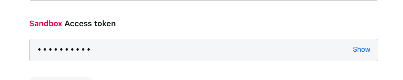
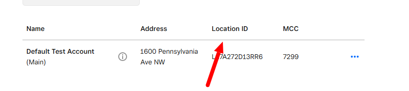
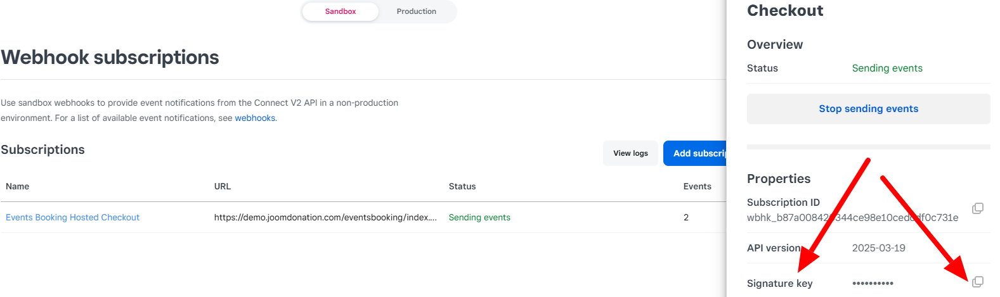

## Installation
When you purchase the payment plugin, you will receive a zip file called **os_eb_squarehostedcheckout.zip**. Go to **Payment Form** -> **Payment Plugins** to install it as any other payment plugin. See [**Install Payment Plugin**](/basic-setup/payment-plugins#install-new-payment-plugin) for installation instructions if needed..

## Configuration

1. Create a Square APP

- Go to https://developer.squareup.com/console/en/apps
- Create an app if you already don't have one for Payment Form use on the website yet
- Click on the app to go inside the app.

2. Enter necessary payment plugins parameters

Go to **Payment Form** -> **Payment Plugins**, click on os_squarehostedcheckout payment plugin to edit and enter the following parameters:

- **Access Token**: Inside the app, you can easily see and get Access Token 

- **Location ID**: Inside the app, click on **Locations** link at the left and get Location ID from there

- **Signature Key**: You can get data **Signature Key** data of the webhook which you create in next step.

- **Order Prefix**: This is optional. You might want to enter a prefix for this parameter to make sure payment note passed to Square unique.

3. Create Webhook

Inside the app, from left menu, go to **Webhooks >> Subscriptions**, and add a new webhook subscription

- **Webhook URL** : **https://domain.com/index.php?option=com_pmform&task=payment_confirm&payment_method=os_squarehostedcheckout**

(Of course, need to replace https://domain.com/ with your site url)

- **Events**: Select **payment.created** and **payment.updated**

After creating webhook, get **Signature Key** of the webhook and enter it into **Signature Key** parameter of the payment plugin. 

