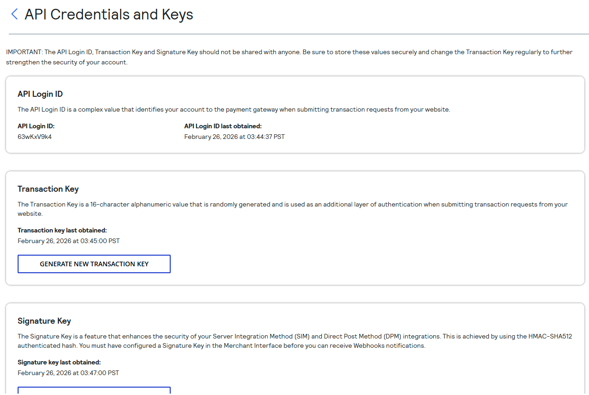
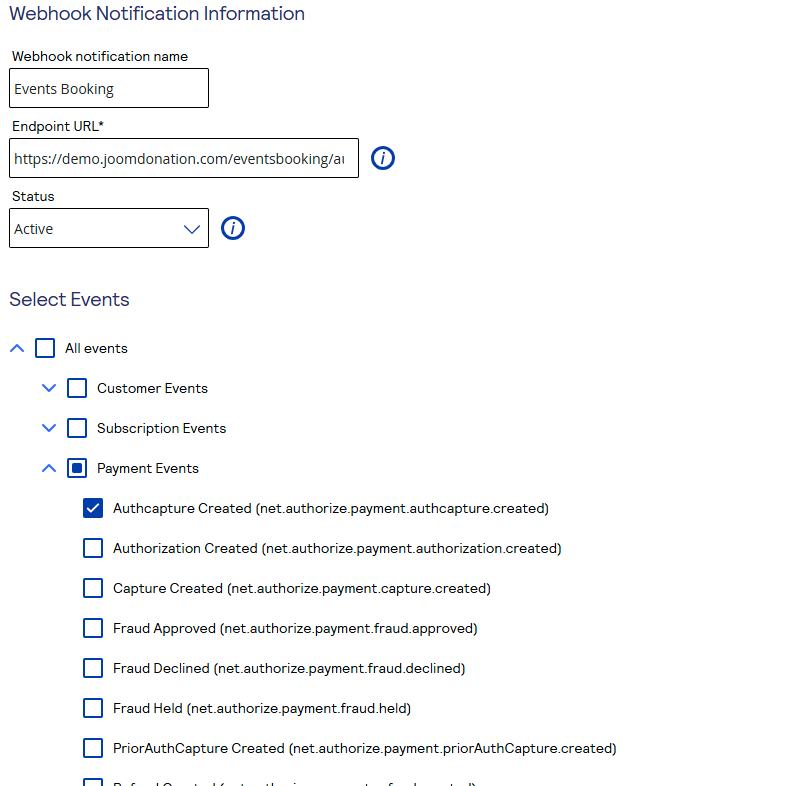

## Installation
When you purchase the payment plugin, you will receive a zip file called **os_pmf_authnetaccepthosted_unzip_first.zip**. Unzip the zip file, you will get the payment plugin file **os_pmf_authnetaccepthosted.zip** and three PHP files. 

- Go to **Payment Form** -> **Payment Plugins** to install the payment plugin **os_pmf_authnetaccepthosted.zip** as any other payment plugin. See [**Install Payment Plugin**](/basic-setup/payment-plugins#install-new-payment-plugin) for installation instructions if needed..
- For the three PHP files: **authaccepthosted_pmf_cancel.php**, **authaccepthosted_pmf_return.php**, **authaccepthosted_pmf_webhook.php**, please upload it to root folder of your site. If you use Admin Tools Pro htaccess marker, please make sure these three files are accessible by adding it to **Exceptions from Server Protection** section and re-generate the .htaccess file.

## Configuration

1. Login to your authorize.net account, access to **Account** -> **Account and API Settings**  -> **API Credentials and Keys**. Get API Login, Transaction Key (generate it if needed), Signature Key (generate if needed) and enter it to Associated parameters in the **os_authnetaccepthosted** payment plugin parameters.

3. Also in **Account** -> **Account and API Settings**  -> **API Credentials and Keys** -> Webhooks, create a new webhook
- The webhook URL is https://yourdomain.com/authaccepthosted_eb_webhook.php (replace https://yourdomain.com with URL of your site)
- Select event **Authcapture Created (net.authorize.payment.authcapture.created)** for the webhook

