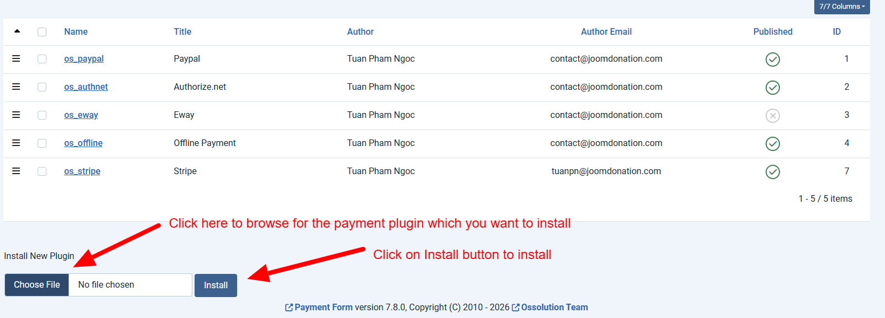

Payment Form includes [PayPal Standard](/basic-setup/payment-plugins/paypal), [Authorize.net](/basic-setup/payment-plugins/authorize-net), and [Eway](/basic-setup/payment-plugins/eway) for online payments. It also includes [Offline Payment](/basic-setup/payment-plugins/offline-payment) for methods such as bank transfer or cash.

In the Joomla administrator area, go to **Components → Payment Form → Payment Plugins**. From within Payment Form, you can also open **Setup → Payment Plugins**.

## Install New Payment Plugin

Additional gateways are available from the [Payment Form payment plugins catalog](https://joomdonation.com/payment-plugins/payment-form-payment-plugins.html), usually as paid add-ons. You can also install a custom payment plugin developed for Payment Form.

1. Open **Payment Plugins** and scroll to **Install New Plugin** below the list.
2. Click **Choose File** and select the plugin ZIP. If the download is marked `unzip_first`, extract it and select the plugin ZIP inside. Follow the gateway's setup guide for any additional files or steps.
3. Click **Install**. The new plugin appears in the list as unpublished. Click its name to configure it.

To update an installed plugin, upload its newer ZIP here. After the update, check the settings and restore your custom **Title** if the installer replaced it.

## Configure and test a payment method

1. Click the plugin's **Name** to edit it. Use the relevant gateway guide in this chapter to configure credentials and any required webhooks. For an online gateway that supports sandbox or test mode, start with test credentials on a test site.
2. Set a **Title** that payers will recognize, such as **Credit or debit card** or **Bank transfer**. Set **Access** to **Public** if guests should be able to use the method. Choose a more restrictive Joomla viewing access level if the method is for a specific audience.
3. Set **Published** to **Yes** and save. You can also publish a plugin from the list using its status icon or the **Publish** toolbar button.
4. Edit the [form](/basic-setup/forms/add-new-form#advanced-settings) and select the plugin under **Advanced Settings → Payment Methods**. Select **All Payment Methods** if the form should offer every published method the payer has access to, including methods you publish later.
5. Open the form as the intended payer and complete a test payment. For a successful online payment, confirm that the record appears as **Paid** under **Payment Form → Payments**. For an offline method, check the payment instructions and confirm that the record appears as **Pending**. On the live site, use the gateway's live credentials and webhook settings.

If a method is missing on a form, check that the plugin is published, that the form's **Payment Methods** selection includes it, and that the payer has the required viewing access level.

## Change the order and default method

In **Payment Plugins**, click the ordering column header to enable drag-and-drop if the handles are inactive. Move the preferred method above the other methods offered on the form. Payment Form uses this order to display methods and determine the default selection. The order is shared across forms, so check the default on each form that offers the reordered methods.

## Use different gateway credentials on different forms

Use **Duplicate** when two forms need separate accounts or credentials for the same gateway. For example, you can use separate merchant accounts for a donations form and a membership payment form.

1. Select the existing plugin in **Payment Plugins** and click **Duplicate**. Payment Form creates an unpublished copy with the original settings and a name such as `os_paypal_1`.
2. Open the copy, give it a clear **Title**, and replace the copied credentials and any other account-specific settings. Check the gateway's webhook requirements for the new account, then publish the copy when it is ready to test.
3. In each form's **Advanced Settings → Payment Methods**, select the intended plugin instance explicitly. Test both forms to verify that each payment goes to the intended account.

## Translate a payment method title

1. Edit the plugin and set **Title** to a language key, such as `PF_PAY_BY_BANK_TRANSFER`.
2. Open **Payment Form → Translation**, choose **Payment Form Component** and **en-GB**, and click **New Item**. Enter the same key in **Key** and its English title in **Translation**, then save.
3. Select each other language used on the site, translate the new item, and save. Check the title on the form in each language.

## Unpublish or uninstall a payment plugin

**Unpublish** a plugin to hide it from forms while keeping its settings. Click its icon in the **Published** column, or select it and click **Unpublish** in the toolbar.

**Uninstall** a plugin to remove it and its saved settings. Select the plugin in **Payment Plugins**, click **Uninstall**, and confirm. To uninstall an original plugin with duplicates, uninstall its copies first.

Before retiring a method, check the forms that use it and make sure they still offer a working payment option. If online payments are still awaiting gateway confirmation, choose replacement methods explicitly on the affected forms and keep the old plugin published until those payments are confirmed. Unpublishing or uninstalling can also affect refunds initiated from Payment Form for payments made with that method.
