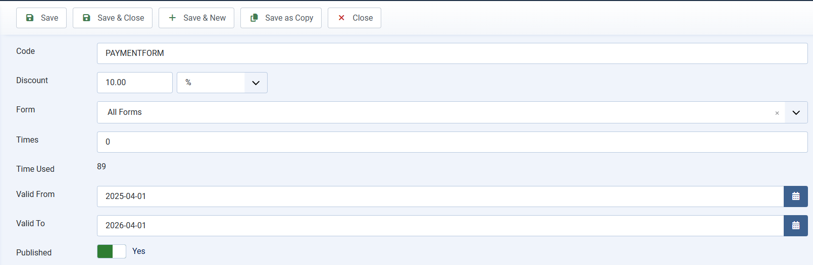

**Payment Form** allows you to create coupon codes to give discount to your users when they make payment on your site.

To access to coupons management page, there are 3 different ways:
1. Access to **Components -> Payment Form -> Coupons**
2. Access to Payment Form Dashboard, then click on **Coupons** icon.
3. On any pages in Payment Form, access to **Setup -> Coupons**

## Add New Coupon
Press **New** button to create new coupon

1. **Code**: The code for this new coupon.
2. **Discount**: Enter the discount for this coupon. Discount can be set to a fixed amount (for example 10$) ro by percent (for example 10% of subscription fee).
3. **Form**: Choose the form(s) which this coupon code can be used. Choose **All Forms** if you want this coupon code can be used for any forms.
4. **Times**: Enter number of times this coupon code can be used. If you leave it empty, the coupon code can be used unlimited times.
5. **Valid From**: If you choose a date, the coupon code can only be used **from the selected date**.
6. **Valid To**: If you chose a date, the coupon code can only be used before the selected date. After that date, the coupon code cannot be used anymore.

