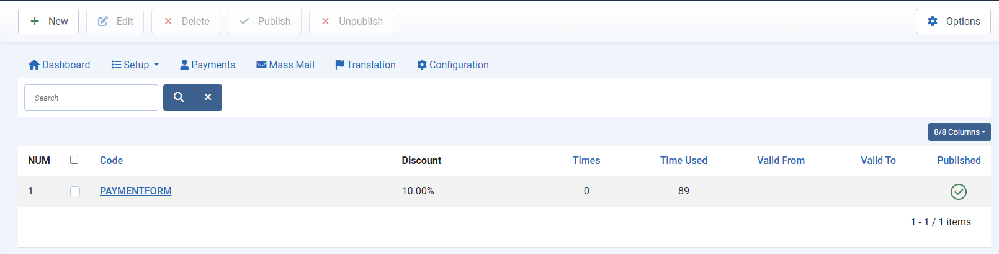

Use coupons to offer a percentage or fixed-amount discount on a payment. Create and publish the code, then turn on **Enable Coupon** for each form where payers should be able to enter it. This form setting is required even if the coupon is assigned to **All Forms**.

## Add new coupon

In the Joomla administrator area, go to **Components → Payment Form → Coupons**. You can also select **Coupons** from the Payment Form dashboard or open **Setup → Coupons** from another Payment Form page.

Select **New**, configure the coupon, then save it.

| Setting | What to enter |
| --- | --- |
| **Code** | The code payers enter, such as `SAVE10`. |
| **Discount** | Enter a number and select **Percent** or **Fixed Amount**. For example, `10` gives 10% off with **Percent**, or 10 units of the form's currency off with **Fixed Amount**. Percentage discounts apply to the amount including custom field fees and any late fee, before tax and payment processing fees. |
| **Form** | Select one published form, or choose **All Forms** to make the code available on any form where coupons are enabled. |
| **Times** | The maximum number of uses for this code across all eligible forms. Enter `0` for unlimited use. Payment Form counts a use when it creates the payment record, so a pending payment can count toward the limit. The **Time Used** counter shows how many uses have been recorded. |
| **Valid From** | When the code becomes available. Leave blank to allow immediate use once the coupon is published. |
| **Valid To** | When the code expires. Leave blank for no expiration date. |
| **Published** | Set to **Yes** to make the code available within the limits above. |

## Show the coupon field on a form

1. Go to **Components → Payment Form → Forms** and open the form that should accept the coupon.
2. On the **General** tab, set **Enable Coupon** to **Yes**, then save the form. Repeat this for each form that should accept coupons.
3. Open the form on your site. Enter the code in the **Coupon** field near the payment amounts, then press Tab or click outside the field. Check that the discount appears and the amount due updates.

## Why can't I see the coupon field?

- **Check the form's settings.** Confirm that **General → Enable Coupon** is set to **Yes** on the form displayed on the page. This is a per-form setting and defaults to **No**.
- **Check how the form calculates payment.** The built-in layouts show the payment amounts when the calculated amount is greater than zero or the form has a [custom fee field](/basic-setup/custom-fields/custom-fee-fields). A free form with no fee fields has no payment amounts section, so the **Coupon** field is hidden. If payers enter the amount or choose priced options, check that the relevant custom fields are configured as fee fields.
- **Check the layout if your site customizes it.** If the form uses a custom layout or a Joomla template override, preview it with a built-in layout without the override. If the field appears there, check that the customized layout includes the payment amounts section and the **Coupon** field.

If the field appears but the code is rejected, check the spelling, **Published** status, selected **Form**, validity dates, and remaining uses under **Coupons**.
