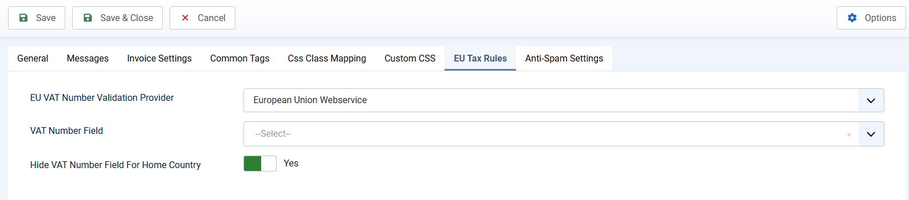

Payment Form supports EU Tax Rules. So if you need to support EU Tax Rules in Payment Form:

- Go to Payment Form -> Custom Fields, create a Text custom field to allow users to enter VAT Number.
- Go to Payment Form -> Configuration, look at **EU Tax Rules** tab:

1. Make sure **Default Country** config option set to a EU Country
2. In **EU VAT Number Validation Provider**, choose the provider you want to use to validate VAT Number
3. In **VAT Number Field**, select the the field which you created above to allow entering VAT Number
4. You should have **Hide VAT Number Field For Home Country** config option to Yes. The reason is because for users from home country, they will always be charged tax, so no need to ask them to enter VAT Number

With that setup, when users make payment on your form, they will be charged tax follow EU Tax Rules.

