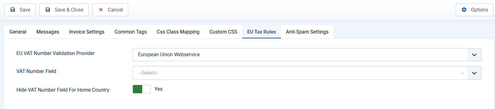

Payment Form can add a fixed percentage set on each form or calculate VAT from the customer's country and VAT number. The EU VAT settings apply across the component.

## Charge a fixed tax rate

1. Go to **Components → Payment Form → Forms** and edit the form.
2. Under **General**, enter the percentage in **Tax Rate**. For example, enter `10` for 10%. Enter `0` for a form that should charge no fixed tax.
3. Save the form and check the total on the site. Payment Form applies tax after coupon discounts and before any payment-method processing fee. For example, a charge of 100 with a discount of 10 and a tax rate of 10% totals 99 before processing fees.

If **Tax Rate** is hidden in the form editor, EU VAT is active. To return to fixed rates across the component, clear **VAT Number Field** under **Configuration → EU Tax Rules**.

## Calculate EU VAT

1. In **Components → Payment Form → Custom Fields**, create and publish an optional **Text** field for the VAT number. Assign it to the forms that should collect VAT numbers. Make sure those forms also show Payment Form's built-in **Country** field. Payment Form uses **Default Country** for a submission that omits the country.
2. In **Payment Form → Configuration → General**, set **Default Country** to your EU home country. In **EU Tax Rules**, select the custom field under **VAT Number Field**. Together, these settings activate EU VAT in Payment Form.
3. Under **EU VAT Number Validation Provider**, choose **European Union Webservice** (the default) or **vatcomply.com API**. Leave **Hide VAT Number Field For Home Country** set to **Yes** to hide the input for customers who select your home country.
4. Save and test the total on the site with different countries. Payment Form applies its home-country rate to customers from that country. For another EU country, it applies that country's rate when the customer leaves the VAT number blank and charges no VAT when the number validates. For a country outside the EU, it charges no VAT.

