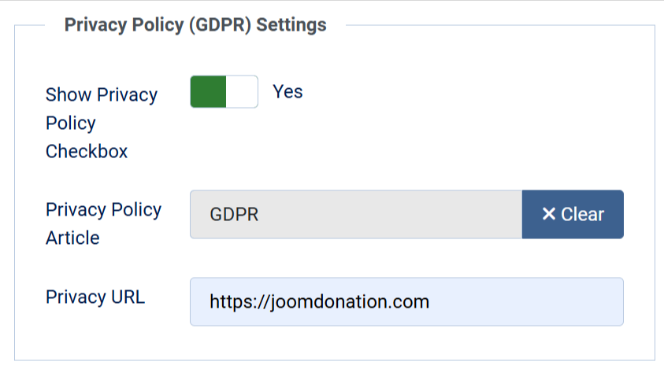
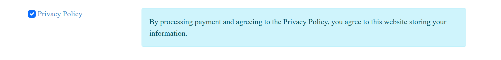

[GDPR](https://en.wikipedia.org/wiki/General_Data_Protection_Regulation) is now supported in **Payment Form**. If you run a website require compatible with this rule, You can go to **Payment Form** -> **Configuration**, look at **Privacy Policy (GDPR) Settings** section, change the necessary settings to have Payment Form compatible with that requirement:

1. **Show Privacy Policy Checkbox**: Set to Yes
2. You can create a Privacy Policy Article and select that article for **Privacy Policy Article** setting
3. Or if you have a page (for example, build by page builder) to show Privacy Policy, you can enter URL of that page into Privacy Policy URL textbox.

With that setup:

1. Users  will have to check on **Privacy Policy** checkbox to process the payment. They can also click on **Privacy Policy** to see the privacy policy article.
2. The default privacy short text is **By By processing payment and agreeing to the Privacy Policy, you agree to this website storing your information.**. If you want to change it, you can go to Payment Form -> Translation, find the language item PF_AGREE_PRIVACY_POLICY_MESSAGE and change it.

