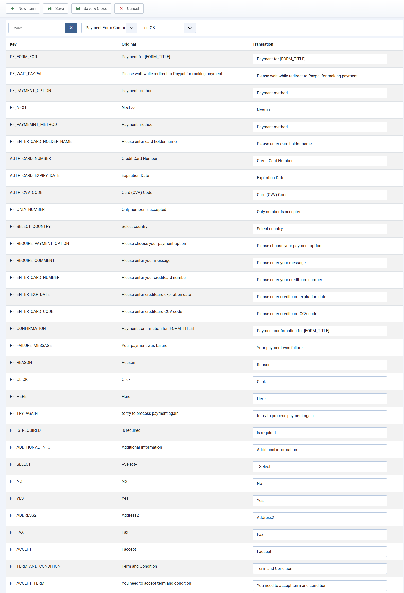

Translation is a very useful feature in **Payment Form**. It allows you to change existing language items, translate the extension (both frontend and backend language files) to other languages without having to access to language file directly

To access to Translation management page, there are 3 different ways:

1. Access to **Components -> Payment Form -> Translation**
2. Access to Payment Form Dashboard, then click on **Translation** icon.
3. On any pages in Payment Form, access to **Translation**.

## Update / Change existing language items
If you need to update an existing languages items, on Translation management screen, search for that language item / language string, make the change, the press Save button in the toolbar to get it saved.

## Add New Language Item
Sometime, you will have to add a new language item to your language file. This usually needed when you install a new payment plugin and need to add extra language items to the extension

To do that, please follow the steps below:
1. Press **New Item** Button in the toolbar
2. Enter the **language key** into **Key** textbox
3. Enter the **language string** corresponding to that **language key** into **Translation** textbox
4. Press **Save** button in the toolbar

## Translate Language Files To New Language

If you use a none Engling language in Payemnt Form and there is not a language package for that language avialable yet, you will need to translate language files of Payemnt Form from English to your language. To do that, on Translation Mangement Screen:

1. Select the language you want to translate to in **Select language** dropdown
2. Do the translation
3. Press **Save** button in the toolbar