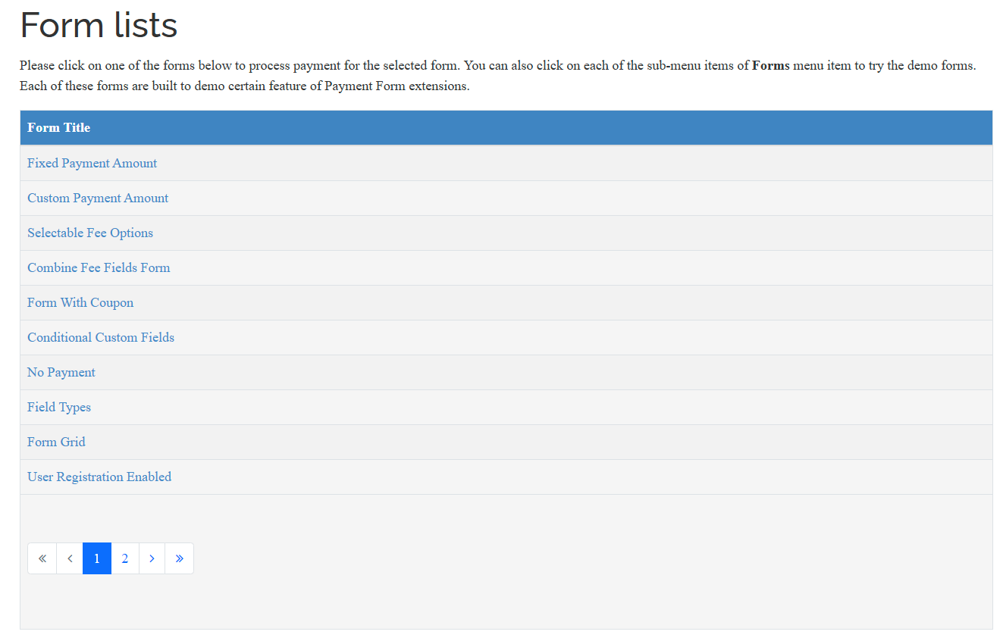
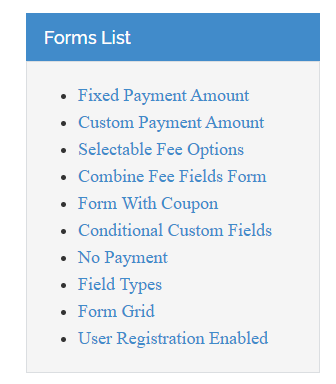

Payment Form has different options to display list of forms to allow users to select the form they want to process payment. 

## Use Forms List menu item type
The Forms List menu item type displays a browsable list of payment forms on your Joomla site. This view presents multiple forms in a structured table format, allowing users to see available options and select which form they want to access. It acts as a central hub for all your payment forms, making it easy for visitors to discover and choose the appropriate form for their needs.

The forms list automatically displays key information about each form, including the form title, and optionally the payment amount. Users can click on any form in the list to navigate to that specific form's page.

To use this option, please create a menu item to link to **Form List** menu item type of **Payment Form**.  The menu item type has follow parameters:
- **Forms**: Allow you to select only certain forms to display. If no forms are selected, all published forms will be displayed.
- **Show Amount Columns**: Determine whether the Amount column will be displayed. It is off by default, normally, you should only set it to Yes if all the forms displayed here have fixed payment amount.
- **Intro Text**: Allow you to enter the text you want to display above the list of form.

## Use Payment Form - Forms List module
The other option to display list of forms is using **Payment Form - Forms List** module. In this case, the forms will be displayed in a module position of your site template. 

If you want to use this option, create an instance of **Payment Form - Forms List** module and assign it to the module position you want. The module has following parameters:

- **Forms**: Select the forms you want to display in this module. If no forms are selected, all publish forms will be displayed
- **Number Forms**: Determine how many forms will be displayed in the module.

