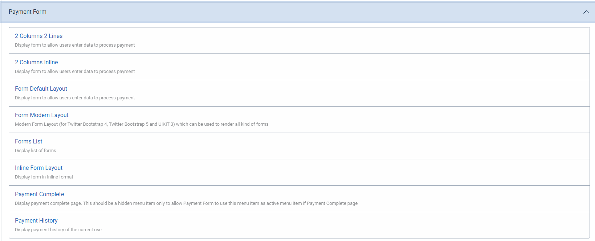
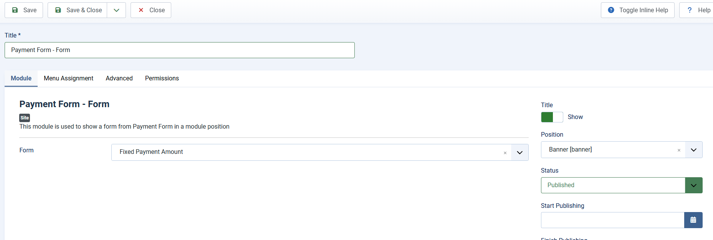

Payment Form has different options to show form to users: Through menu item, embed form in a Joomla article or use module to display form in a module position on your site. Find out how to use these options in sections below:

## Use menu item

You can create a menu item to link to one of menu item types below of Payment Form to display a single form. However, we recommend to use **Form Modern Layout** menu item type, all other menu item types were using in old days and will be removed in the future. For layout examples and setup instructions, see [Modern Form Layouts](/basic-setup/forms/modern-form-layouts).

| Menu item type | Layout |
| --- | --- |
| **Form Modern Layout** | Recommended. Configure field columns, label placement, or a custom grid. |
| **Form Default Layout** | Display the form with the default layout. |
| **Inline Form Layout** | Display the form with the inline layout. |
| **2 Columns 2 Lines** | Display fields in two columns with labels above the inputs. |
| **2 Columns Inline** | Display fields in two columns with labels beside the inputs. |

## Embed the form in a Joomla article
The **Content - Payment Form** plugin allows you to embed a form in a Joomla article. If you want to have that behavior, follow the instructions below to setup:

1. Go to **System → Plugins**, find and  and enable **Content - Payment Form** plugin.
2. Open the Joomla article and enter `{pmform FORM_ID}` where you want the form to appear. Replace `FORM_ID` with the ID of the form. For example, `{pmform 2}` displays form with ID =  2. Use exactly one space between `pmform` and the ID.
3. Save the article.

## Show the form in a module position
If you want to display a form in a module position on your site, access to System -> Site Modules, press new button in the toolbar to create an instance of **Payment Form - Form** module, select Form, choose position, assign it to the pages/menu items you want and publish it.

