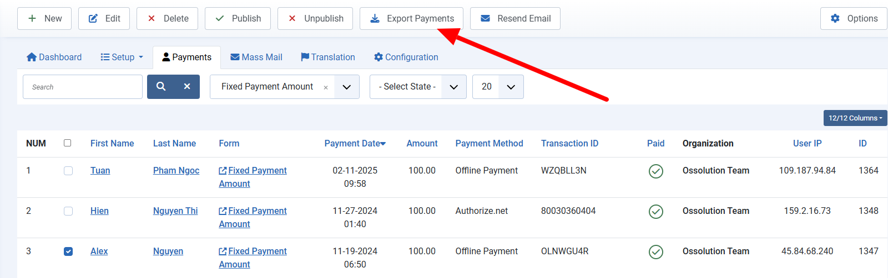

Use **Export Payments** to download payment records as a CSV file that you can open in Excel or another spreadsheet application.

1. Open **Components → Payment Form → Payments**.
2. Select a form to limit the export to that form, or leave **Select Form** at its default to include records from all forms. You can also narrow the results by status, search term, or an available custom field filter.
3. To export specific records, select their checkboxes. Leave all boxes clear to export every record that matches the current filters, including matches on other pages.
4. Click **Export Payments** to download `payment_records.csv`.

The CSV includes standard payment details such as amounts, payment method, status, and transaction ID. To include a form field, publish the field and set **Show On Export** to **Yes**. If your spreadsheet opens the data in a single column, use the delimiter set under **Payment Form → Configuration → General → CSV Delimiter** when importing the file.

The CSV currently labels refunded payments as **Paid** if they are included in the export. Check the **Refunded** badge in the Payments list before using the CSV to reconcile refunds.
