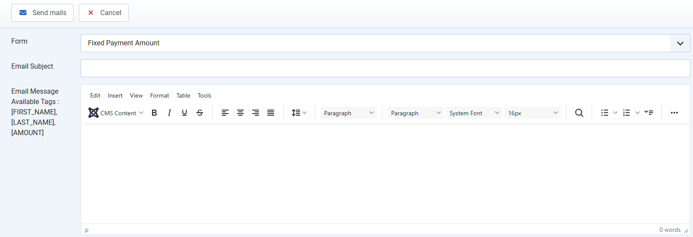

Use **Mass Mail** to send a one-time message about a specific form, such as a change to the service or event that customers paid for.

1. Open **Components → Payment Form → Mass Mail**.
2. Select a published form and enter the **Email Subject** and **Email Message**.
3. To personalize the message body, use `[FIRST_NAME]`, `[LAST_NAME]`, or `[AMOUNT]`.
4. Review the selected form and message, then click **Send Mails**.

Mass Mail sends one message per eligible payment record with a valid email address. It includes paid online records and offline records, including pending offline payments. A customer with multiple eligible records can receive multiple copies. To send the standard payment emails for specific records, see [Resend Email](/payments-management/resend-email).
