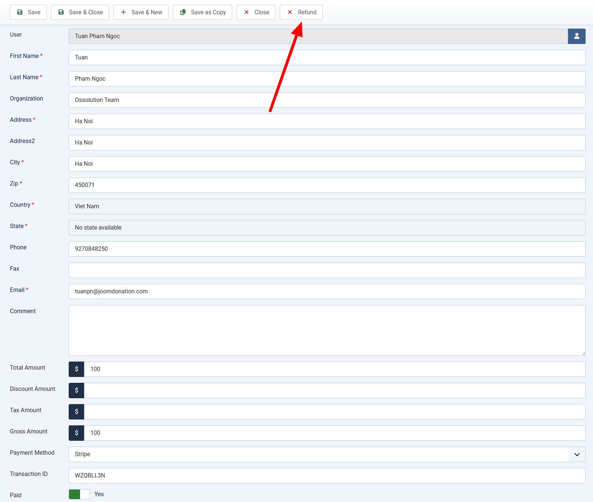

Use **Refund** to return a payment through its original payment gateway. The payment must be **Paid**, have a positive **Gross Amount**, and have a transaction ID. The payment plugin must support refunds and your account must have **Configure ACL & Options** permission for Payment Form.

For the built-in PayPal plugin, enter your REST API **Client ID** and **Client Secret** on the plugin's **Advanced** tab. In sandbox mode, use **Sandbox Client ID** and **Sandbox Client Secret**. See [Payment Plugins](/basic-setup/payment-plugins).

1. Open **Components → Payment Form → Payments** and edit the payment record.
2. Verify the payment amount and transaction ID. The refund dialog asks for confirmation and has no field for a partial refund amount.
3. Click **Refund** and confirm. After processing, check that the record displays **Refunded** in the Payments list. If an error appears, check the transaction in your gateway account before retrying.

To customize the email sent to the customer after a successful refund, edit **Payment Refunded Email Subject** and **Payment Refunded Email Body** under **Payment Form → Configuration → Messages**. Leave the subject blank to skip this email. See [Messages](/getting-started/configuration/messages).
