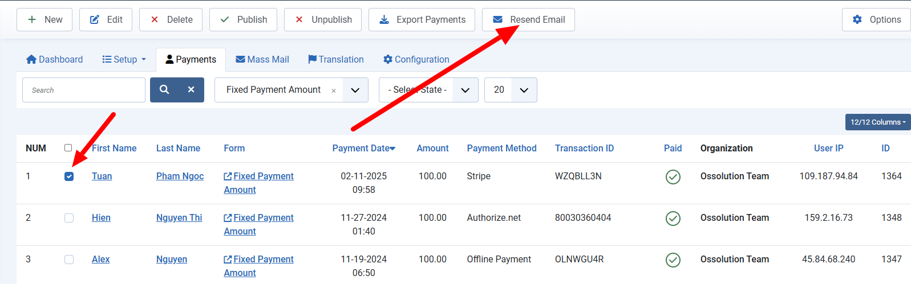

Use **Resend Email** if a customer missed their payment email or needs a new copy after you correct their payment details.

1. Open **Components → Payment Form → Payments**.
2. Check that the record has the correct email address and payment details.
3. Select the checkbox for each payment. When resending multiple payments, select one form at a time.
4. Click **Resend Email** in the toolbar.

Payment Form uses the current payment details and email settings to send the customer confirmation and the administrator notification again. For an offline payment, it uses the offline confirmation template, even if the payment has since been approved. The separate approval and refund emails are sent when those actions are processed. See [Messages](/getting-started/configuration/messages).
