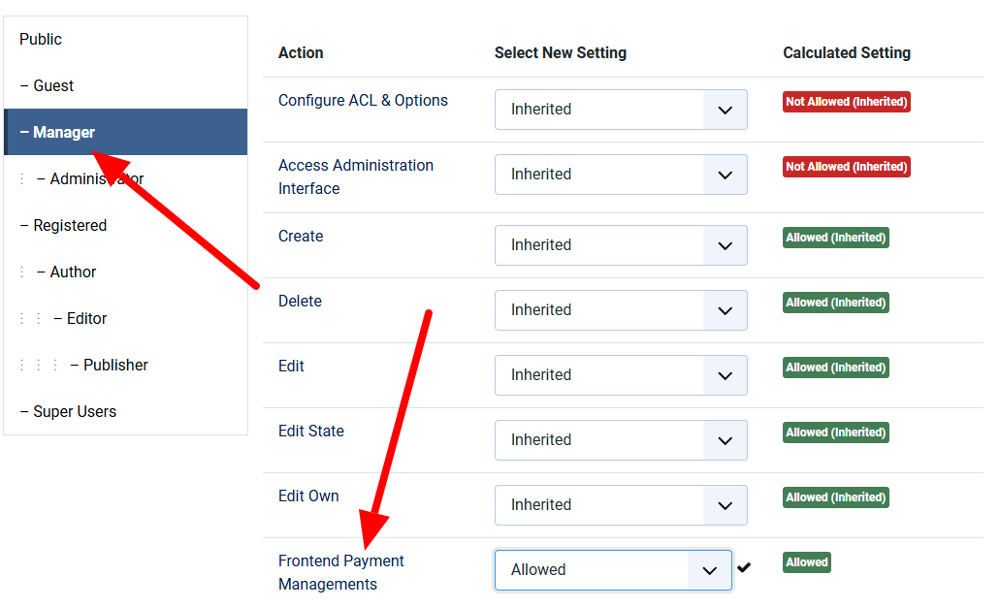
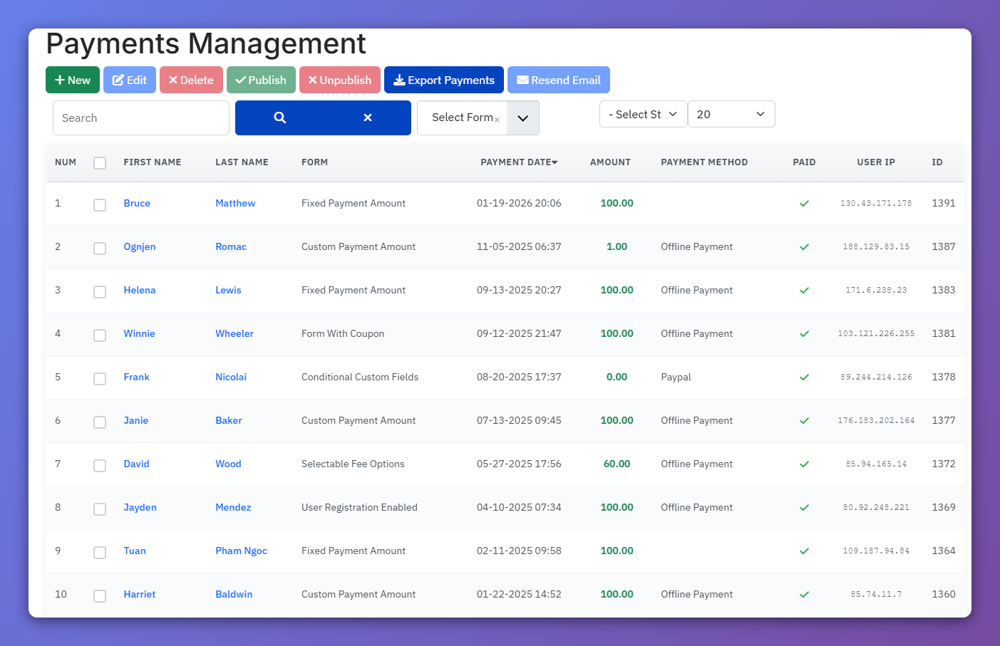

Add a **Payments Management** page to your Joomla site so staff or clients can manage payment records without signing in to the administrator area. The page gives authorized users access to records across forms. If customers only need to see their own payments, add a [Payment History](/frontend-items/payment-history) menu item for them.

## Set up permissions

1. In the Joomla administrator area, go to **Components → Payment Form → Payments**. Click **Options**, then open the **Permissions** tab.
2. Select the Joomla user group that will manage payments. For example, create a **Payment Managers** group under **Registered** and assign the staff accounts to it.
3. Set **Frontend Payment Managements** to **Allowed**. Grant the additional permissions the group needs, then save.

| Permission | What it allows |
| --- | --- |
| **Create** | Add payment records manually. |
| **Edit** | Save changes to existing payment records. |
| **Edit State** | Use **Publish** and **Unpublish** and change the **Paid** field in the payment editor. |
| **Delete** | Delete payment records. |

The menu item works without **Access Administration Interface** permission for Payment Form. Users who already have **Configure ACL & Options** for Payment Form can also open the management page if the menu item's viewing access level allows it.

## Create the Payments Management menu item

1. In Joomla, go to **Menus**, open the site menu where the link should appear, and click **New**.
2. Enter a **Menu Title**, such as **Manage Payments**. Under **Menu Item Type**, click **Select** and choose **Payment Form → Payments Management**.
3. Set **Access** to a viewing access level that includes the group you configured. To make the link visible only to payment managers, create a dedicated level under **Users → Access Levels** and assign it to the menu item. Payment Form checks the component permissions when users open the page.
4. Set **Status** to **Published** and save. Sign in to the site with a payment manager's account and confirm that the intended actions are available.

The menu item has four optional column settings, all set to **No** by default. Enable **Show Coupon**, **Show Payment Method**, **Show Transaction ID**, or **Show User IP** to display the corresponding details in the list.

## Find and manage payments

Open the new menu item on the site. Search by payer name, email address, or transaction ID. To find a record by its **ID**, enter a search such as `id:123`. Use **Select Form** to narrow the list to a published form. Under **Select State**, choose **Published** for paid records or **Unpublished** for pending records. Clear the state filter to see records marked **Refunded**.

If an unfinished online payment is missing, check **Show Incomplete Payment Records** under **Payment Form → Configuration → General**. Pending offline payments appear with either setting.

| Task | What to do on the site |
| --- | --- |
| Add a manual payment | Select a form, click **New**, and enter the payer details, payment method, and amounts. If you have **Edit State** permission, **Paid** defaults to **Yes**. Set it to **No** when you're still waiting for an offline payment. |
| Edit a payment | Select the record and click **Edit**. Saving an online payment sets it to **Paid**, so verify a pending transaction at the gateway before saving it. |
| Approve an offline payment | After verifying receipt, select the pending record and click **Publish**. Payment Form runs the configured payment-success integrations and sends the approval email if configured. See [Approve Payments](/payments-management/approve-payments). |
| Export to CSV | Apply the list filters and click **Export Payments**. Select specific records with their checkboxes, or leave the checkboxes clear to export all matching records, including those on other pages. See [Export Payments](/payments-management/export-payments). |
| Resend payment emails | Select the records and click **Resend Email** to resend the configured customer and administrator payment emails. See [Resend Email](/payments-management/resend-email). |
| Download an invoice | If invoices are enabled, click the number in the **Invoice Number** column to download the PDF. |
| Refund a payment | Open an eligible paid record and click **Refund**. This action requires **Configure ACL & Options** for Payment Form and a payment method that supports refunds. See [Refund Payment](/payments-management/refund-payment). |
| Delete a record | Select the record and click **Delete**. This removes the record and its saved custom field values. Use **Refund** to return a payment through the gateway. |

For bulk announcements to customers, use [Mass Mail](/payments-management/mass-mail) in the administrator area.

