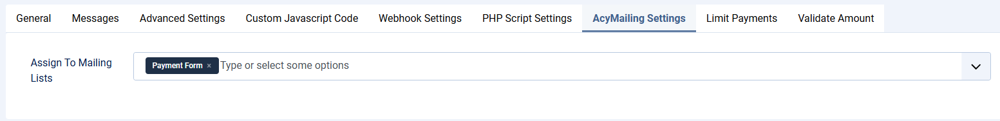

This plugin adding users making payment for your form to the ACYMailing mailing lists you want. And later, you can use ACYMailing to send newsletters to these users if needed.

## Enable And Configure Plugin

To use this feature, go to **System -> Plugins**, find and enable **Payment Form - AcyMailing** plugin. Now, when you add, edit a form, you will see a new tab called **AcyMailing Settings**. Here, you can select the mailing lists you want and when users make payment using the form, they will be subscribed to these selected mailing lists.

