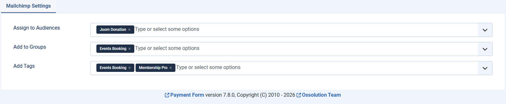

Use **Payment Form - Mailchimp** to add customers to one or more Mailchimp audiences after a successful payment. You can also assign them to groups and apply tags so you can segment contacts by the form they paid through.

## Connect Payment Form to Mailchimp

1. In Mailchimp, set up at least one audience. Create any groups and tags you want to use in that audience.
2. Generate a key for your Mailchimp account. See [Mailchimp's guide to API keys](https://mailchimp.com/help/about-api-keys/).
3. In the Joomla administrator area, go to **System → Plugins** and open **Payment Form - Mailchimp**. Enter the key in **API Key**, enable the plugin, and save it.

**Double opt-in** applies to all forms using this plugin. By default, **No** adds new contacts as subscribed. Choose **Yes** to add them as pending until they confirm their subscription. See [Mailchimp's guide to double opt-in](https://mailchimp.com/help/about-double-opt-in/).

## Choose audiences, groups, and tags for a form

Go to **Components → Payment Form → Forms**, open the form, and select the **Mailchimp Settings** tab.

| Setting | What to select |
| --- | --- |
| **Assign to Audiences** | Select at least one audience for this form to send contacts to Mailchimp. |
| **Add to Groups** | Optionally select groups that belong to the audiences you selected above. |
| **Add Tags** | Optionally select tags that belong to the audiences you selected above. |

The group and tag fields appear when the plugin finds groups or tags in Mailchimp. A group or tag takes effect only when its audience is selected on the form. Save the form and repeat these steps for each form you want to connect to Mailchimp.

## Test the integration

Complete a test payment using an email address that is new to the selected audiences. If you use an offline payment method, [approve the payment](/payments-management/approve-payments) first. In Mailchimp, look up the contact in each selected audience and check its groups, tags, and subscription status. If you enabled **Double opt-in**, check that the contact can confirm the subscription.

If the **Mailchimp Settings** tab is missing or empty, check that the plugin is enabled and that you saved a valid API key for the account that manages the audiences. If the contact is missing after the payment is marked **Paid**, check the email address on the payment, the audience selections on the form, and `plg_pmform_mailchimp.php` in Joomla's configured log folder for API errors.
