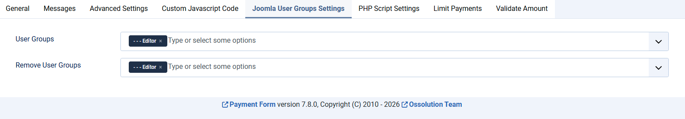

Use **Payment Form - Joomla User Groups** to grant access to restricted Joomla content after payment or move a customer from one user group to another. For example, a course payment form can add the customer to a **Course Participants** group that can access the course materials. Configure the group's access in Joomla before setting up the form.

## Configure group changes for a form

1. In Joomla administration, go to **System → Plugins**, find **Payment Form - Joomla User Groups**, and enable it.
2. Go to **Components → Payment Form → Forms**, edit the form, and open **Joomla User Groups Settings**.
3. In **Add User Groups**, select the groups to assign after payment. This field is labeled **User Groups** in the screenshot below. Select the groups here even if you have configured **Default User Groups** in the plugin settings, since the plugin may skip the default when this field is empty.
4. In **Remove User Groups**, select any groups the customer should leave. If you select the same group in both fields, the plugin removes it.
5. Save the form.

## Test the group changes

Submit a test payment while signed in, or use a form that creates a Joomla account for the customer. The payment must be linked to a Joomla user account for the plugin to update groups. For an offline payment, [mark it as Paid](/payments-management/approve-payments) first.

Open the account under **Users → Manage** and verify its **Assigned User Groups**. Then sign in as the test user and check that the intended content is accessible.
