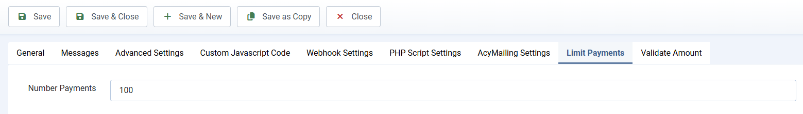

Use **Payment Form - Limit Payments** when you want to close a form after it accepts a set number of payments. For example, if each payment buys one place in a workshop, set a limit of 50 to stop taking submissions once 50 payment records count toward the limit.

## Set a limit

1. In Joomla administration, go to **System → Plugins**, find **Payment Form - Limit Payments**, and enable it.
2. Go to **Components → Payment Form → Forms**, edit the form, and open the **Limit Payments** tab.
3. Enter a positive whole number in **Number Payments** and save. Leave the field blank or enter `0` to turn off the limit for that form.

## How payments count toward the limit

- The plugin counts existing records for the form. Each record counts once, regardless of how many items the customer bought.
- A successful online payment counts once its record is marked **Paid**. An offline payment counts as soon as the record is saved, including while it is **Pending**.
- Once the count reaches the limit, the plugin blocks new submissions. The plugin also attempts to unpublish the form when it reaches the limit. If the form still appears after the last online payment, check its published status in **Forms** and unpublish it manually if needed.

The limit is checked when a customer submits the form. Online payments already in progress can still complete. If you raise or remove the limit on a form that was automatically unpublished, publish it again to reopen it.
