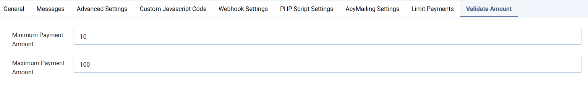

Use **Payment Form - Validate Payment Amount** to set a minimum, a maximum, or both for the amount customers can pay through a form. This is useful when customers enter their own amount, such as on a donation form, or when their choices determine the final amount.

## Configure the amount range

1. In Joomla administration, go to **System → Plugins**, find **Payment Form - Validate Payment Amount**, and enable it.
2. Go to **Components → Payment Form → Forms**, edit the form, and open the **Validate Amount** tab.
3. Enter the bounds you need in the form's currency and save.

| Setting | What it allows |
| --- | --- |
| **Minimum Payment Amount** | The entered amount or higher |
| **Maximum Payment Amount** | The entered amount or lower |

Leave either setting blank or enter `0` to disable that bound. For example, a minimum of 10 and a maximum of 500 allow payments from 10 through 500, including both endpoints.

## What amount is checked?

The plugin checks the final amount due when the customer submits the form. This amount includes applicable discounts, tax, late fees, and payment processing fees. A payment outside the configured range is blocked and the customer sees an error. If you offer coupons or payment methods with different fees, include them when testing the range.
