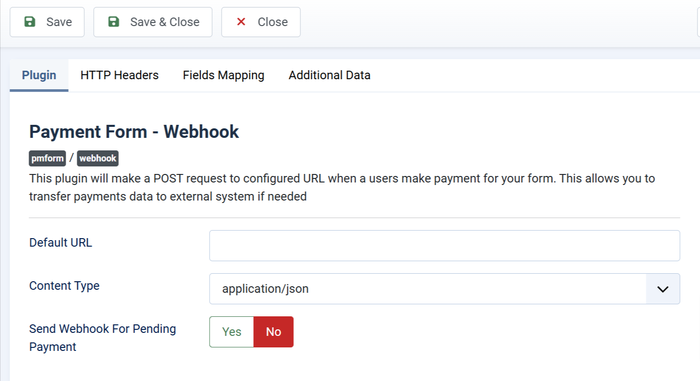
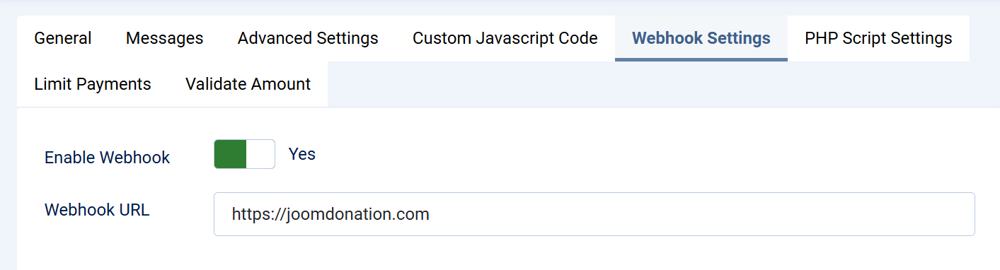

Use **Payment Form - Webhook** to send payment data to a CRM, accounting tool, or another service that accepts HTTP POST requests. Enable it only on the forms whose data should go to that service.

## Configure the plugin

In Joomla administration, go to **System → Plugins**, open **Payment Form - Webhook**, and enable it. Set the following options to match the receiving service.

| Setting | How to use it |
| --- | --- |
| **Content Type** | Use the default `application/json` for JSON, or choose `application/x-www-form-urlencoded` for URL-encoded form data. |
| **Send Webhook For Pending Payment** | Defaults to **No**. Set it to **Yes** to also send a request when a pending offline payment is saved. |
| **HTTP Headers** | Add any headers the service requires, such as an `Authorization` header. |
| **Fields Mapping** | Rename keys to match the service's expected field names. For example, enter `first_name` as the original field name and `firstname` as the new field name. |
| **Additional Data** | Add fixed key-value pairs, such as `source` with the value `payment_form`. If a key matches a key in the payload after mapping, this value replaces it. |

## Enable the webhook for a form

1. Go to **Components → Payment Form → Forms**, edit the form, and open **Webhook Settings**.
2. Set **Enable Webhook** to **Yes**. It defaults to **No**.
3. Enter the receiving endpoint in **Webhook URL** and save. Enter this URL on every form that uses the webhook. The plugin's **Default URL** setting may be ignored when the form's URL is blank.

## When requests are sent

The plugin sends a request after successful payment. For offline payments, this happens when an administrator [marks the record as Paid](/payments-management/approve-payments). If **Send Webhook For Pending Payment** is enabled, the same offline payment can generate two requests, one when the pending record is saved and one when it is approved. Use the payment record `id` to match the two requests and `published` to distinguish pending (`0`) from paid (`1`).

## What the request contains

The payload includes payment details and form field values keyed by the fields' configured names, such as `first_name`, `email`, or `company_name`. Values come from Payment Form's message tags, so some fields may be empty and some values are formatted for display.

| Data | Example keys |
| --- | --- |
| Payment and form identifiers | `id`, `form_id`, `form_title`, `transaction_id` |
| Amounts and currency | `total_amount`, `discount_amount`, `tax_amount`, `payment_processing_fee`, `gross_amount`, `currency` |
| Status and other details | `published`, `payment_date`, `payment_method`, `invoice_number`, `coupon_code` |

Amount fields can contain formatted strings, including the currency symbol. The payment method is the display name. The payload can also contain personal data, including the payer's contact details and IP address.

Complete a test payment and confirm that the receiving service records the request, accepts the headers and field names, and can read the values. The plugin does not retry failed requests, so check the receiving service's request history when troubleshooting.
