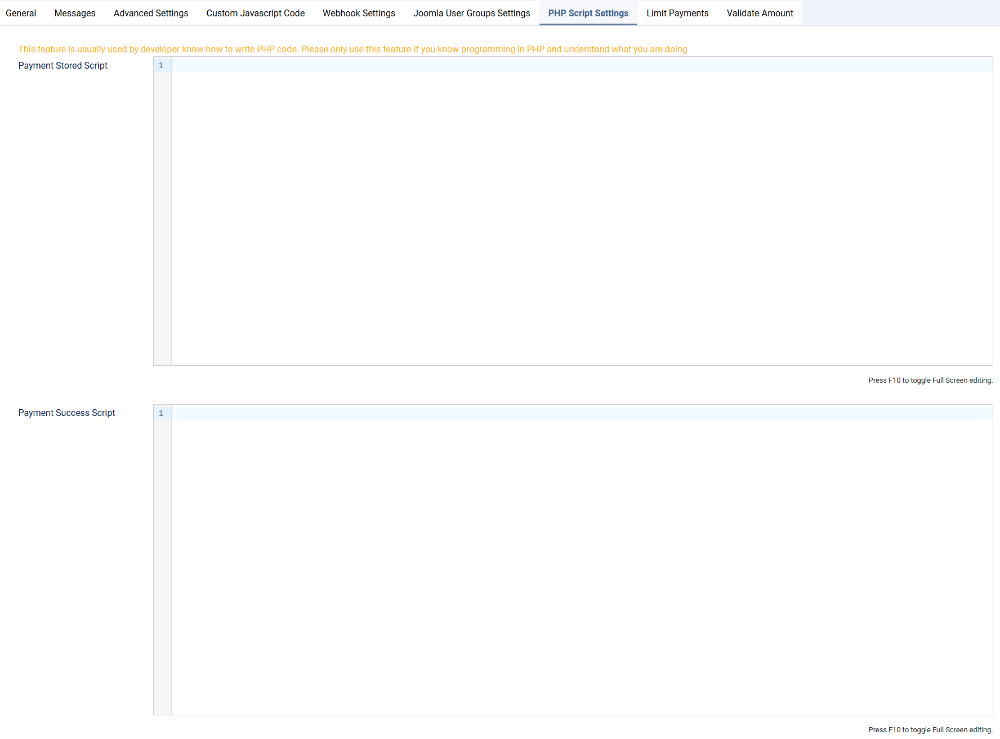

Use **Payment Form - PHP Script** when you need custom PHP code to run during the payment workflow. For example, a developer can record a form submission in another Joomla extension or trigger an action after a payment succeeds.

The scripts run on the server during payment processing. Test them on a staging site before enabling them on a live form, since PHP errors can interrupt processing.

## Add a script to a form

1. In Joomla administration, go to **System → Plugins**, find **Payment Form - PHP Script**, and enable it.
2. Go to **Components → Payment Form → Forms**, edit the form, and open **PHP Script Settings**.
3. Paste PHP statements into the field for the event you want to handle, omitting the opening and closing PHP tags. Leave any unused field blank, then save the form.

| Setting | When it runs | Example use |
| --- | --- | --- |
| **Payment Stored Script** | After a frontend submission saves the payment record and custom field values, before the payment method is processed. This applies to online and offline submissions. | Record a submission as pending in another system. |
| **Payment Success Script** | After a payment succeeds, including when an administrator [marks an offline payment as Paid](/payments-management/approve-payments). | Fulfil an order or update an external record after payment. |



## Read payment and form data

Both scripts receive the payment record as `$row`. Use `$row->id` for the payment record ID, `$row->form_id` for the form ID, `$row->gross_amount` for the calculated amount due, and `$row->user_id` for the Joomla account ID when the payment is linked to an account.

Custom field values are stored separately. Use Payment Form's helper to read them by field name.

```php
use OSSolution\PaymentForm\Site\Helper\Helper as PaymentFormHelper;

$fields = PaymentFormHelper::getFormFields($row->form_id);
$values = PaymentFormHelper::getPaymentData($row, $fields);
$reference = $values['customer_reference'] ?? '';
```

Replace `customer_reference` with the field's configured name. Test the script at the event you selected. For example, submit an offline test payment, check what happens when the record is saved, then approve it and check what happens when it becomes paid.
