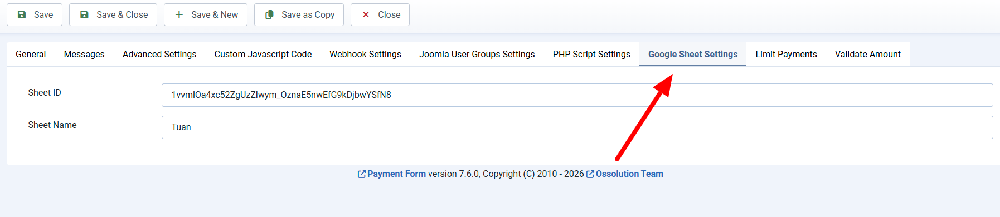

Use **Payment Form - Google Spreadsheet** to keep a form's payment records in a Google Sheets tab for reporting or collaboration. Purchase and download the plugin from the **Paid Add-ons** section of the [Payment Form product page](https://joomdonation.com/joomla-extensions/joomla-payment-form.html). Install it in Joomla, then enable it under **System → Plugins**.

## Set up Google Sheets access

1. In the [Google Cloud console](https://console.cloud.google.com/), create or select a project. Open **APIs & Services → Library**, search for **Google Sheets API**, and enable it.
2. Go to **IAM & Admin → Service Accounts** and click **Create service account**. Give the account a name such as `payment-form-sheets`. You can finish without assigning a project role. You will grant access to the spreadsheet in Google Sheets.
3. Open the new service account and copy its email address. On the **Keys** tab, choose **Add key → Create new key**, select **JSON**, and click **Create**.
4. Rename the downloaded key file to `service-account.json` and upload it to `plugins/pmform/googlesheet/credentials/` on your Joomla site. Keep the key private and ensure the web server blocks public access to the credentials directory.
5. In Google Sheets, open the destination spreadsheet, click **Share**, add the service account's email address, and grant **Editor** access.

If your Google Cloud organization blocks service account key creation, contact your Google Cloud administrator. This plugin looks for a JSON key at the path above. See [Google's service account setup guide](https://developers.google.com/workspace/guides/create-credentials) and [Google's key creation troubleshooting guide](https://docs.cloud.google.com/iam/docs/troubleshoot-org-policies).

## Connect a form to a spreadsheet tab

1. Create a dedicated tab for the form. If you use one spreadsheet for several forms, give each form a different tab.
2. In Joomla, go to **Components → Payment Form → Forms**, edit the form, and open **Google Sheet Settings**.
3. In **Sheet ID**, enter the spreadsheet ID from the URL. In `https://docs.google.com/spreadsheets/d/ABC123/edit#gid=0`, enter `ABC123`.
4. In **Sheet Name**, enter the exact tab name, such as `WorkshopPayments`. If the name contains spaces or special characters, enclose it in single quotes, for example `'Workshop Payments'`. See [Google's guide to A1 notation](https://developers.google.com/workspace/sheets/api/guides/concepts).
5. Save the form. Repeat these steps for each form you want to synchronize.

## How synchronization works

On a sync, the plugin clears the destination tab's cell values and writes the current export from cell A1. Keep manual entries and formulas in a separate tab. The export includes standard payment columns and form fields enabled for **Show On Export**. Payment Form's **Show Incomplete Payment Records** setting also affects which records are included. Pending offline payments can appear in the export.

Saving the form settings prepares the connection. To populate the tab, complete a test payment or open and save an existing payment record without changing its status. The next successful sync includes existing payment records eligible for export. If there are no eligible records left, the plugin skips the export, so the tab can retain the previous data.

## Troubleshoot synchronization

- **Google Sheet Settings is missing.** Check that the plugin is enabled and that `service-account.json` is present at the exact path above. The plugin loads its form settings only when that file exists.
- **The tab is empty after a test payment.** Verify the spreadsheet ID, tab name, service account's **Editor** access, and that the Google Sheets API is enabled for the project. If the write failed, the plugin can record the error in `plugins/pmform/googlesheet/src/Extension/googlesheet_errors_logs.txt`.
- **The tab is stale after a payment status change.** Open the affected payment and save it again without changing its status to trigger a fresh export.
