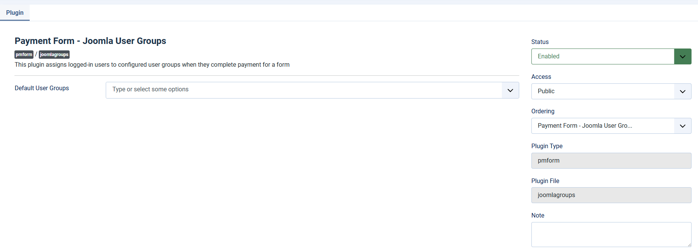
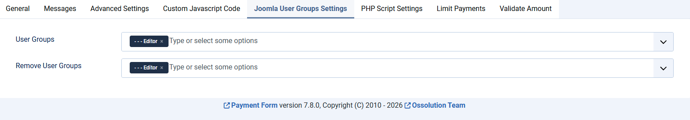

The **Payment Form - Joomla User Groups** plugin automatically manages users' Joomla user group assignments after payment completion. You can configure it to assign users to specified user groups or remove them from selected groups when they complete a payment. This plugin is essential for creating paid membership levels, granting access to restricted content, or managing user permissions based on payment transactions.

## Configuration Instructions

### Step 1: Enable the Plugin

1. Navigate to **System → Plugins**
2. Search for **Payment Form - Joomla User Groups**
3. Click the plugin name to open settings
4. Set **Status** to **Enabled**
5. Configure **Default User Groups** if you want a global default
6. Click **Save & Close**

### Step 2: Configure Per-Form Settings (Recommended)

1. Go to **Components → Payment Form → Forms**
2. Edit the form for which you want to configure user group assignments
3. Click the **Joomla User Groups Settings** tab
4. Select one or more **User Groups** to assign in **User Groups** parameter
5. If you also want to remove users from certain user groups after they complete payment, select those groups in the **Remove User Groups** parameter
6. Click **Save & Close**

With this configuration, when users complete payment through the form, they will be assigned to the selected user groups and removed from the groups specified in the **Remove User Groups** parameter.

**Note:** Users must either register for an account through the form or already be logged in when completing the payment for this feature to work.

