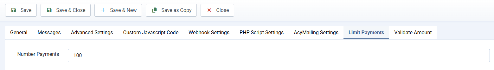

This plugin allows you to limit your form to only accept up to certain maximum number of payments only. After the maximum number payments for the form reached, it will display an error message and users cannot make more payment for that form anymore.

## Enable And Configure Plugin

To use this feature, go to **System -> Plugins**, find and enable **Payment Form - Limit Payments** plugin. Now, when you add, edit a form, you will see a new tab called **Limit Payments**. Put the number you want into **Number Payments** parameter and the form will only accept that maximum number of payments.

