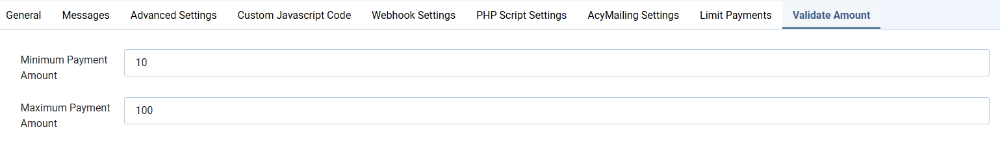

This plugin will prevent users to process payment on the form if payment amount is not in the configured range you want

## Enable And Configure Plugin

To use this feature, go to **System -> Plugins**, find and enable **Payment Form - Validate Payment Amount** plugin. Now, when you add, edit a form, you will see a new tab called **Validate Amout**. 

- If you want payment amount which users process on the form must be greater than or equal certain value, put that value into **Minimum Payment Amount** parameter.
- If you want payment amount which users process on the form must be smaller than or equal certain value, put that value into **Maximum Payment Amount** parameter.

