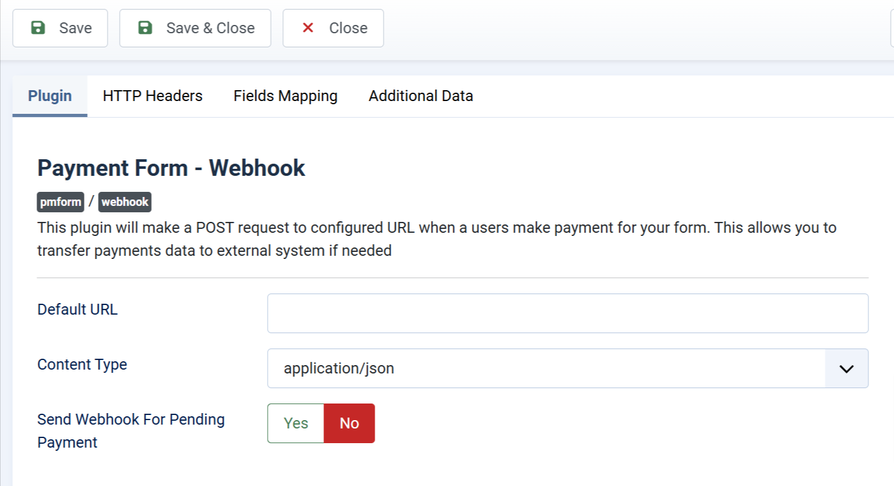
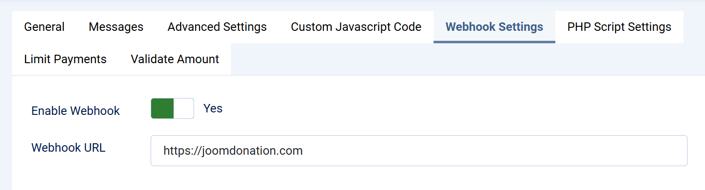

This plugin gives you a way to send payment data to an external URL via a POST request. Whenever someone makes payment for your configured form, a POST request will be sent to the configured URL with all payment data. The external system can then uses that data in the way it wants.

If you want to use this feature, find the plugin **Payment Form - Webhook**, configure necessary parameters and enable it.

## Plugin Parameters

**- Default URL** : That's the default external URL which will receive data sends from Payment Form. Each form can override this default URL if needed.
**- Content Type**: Determine the how the format of data which will be passed to external system. If you choose **application/json**, the external URL will receive data in JSON format. If you choose **application/x-www-form-urlencoded**, the data will be passed in key-value pair (array)

**HTTP Headers**: Allows you to define additional HTTP headers which will be sent in the request (beside the content type header above). Usually, you will need it to pass authentication header so that the external system will allow/except the request.

**Fields Mapping**: If the external system which you want to pass data to expects to receive difference field with the field passed by the plugin, define the field mapping here (kind of field name alias). For example, the plugin pass **first_name** by default, but your system expect to receive **firstname**, you can add a mapping first_name => firstname

**Additional Data**: Allows you to define the extra data (key and it's value) which will be passed to the external URL if needed.

## Enable Webhook for each form
By default, webhook is disabled for all forms. If you want to enable it for certain form, edit the form, look at Webhook Settings tab, set **Enable**  to Yes. Optional, you could also specify URL which will receive webhook data into **URL** inside that form. If the URL is entered there, it will override the default URL configured in the plugin parameter.

## The data sent by the plugin to external URL

When enabled, the plugin will send many data related to that configured URL in a post request. Below are the information of the data which the external system will receive

### Payment Record Data

**Data for any custom fields collected on registration form** 

- first_name
- last_name
- organization
- address
- city
- state
...
- custom_field_1
- custom_field_2
.....

**Other payment related data**
- id
- form_id
- user_id
- total_amount
- discount_amount
- tax_amount
- payment_processing_fee
- gross_amount
- currency
- payment_date
- payment_method
- transaction_id
- published
- language
- invoice_number
- coupon_code