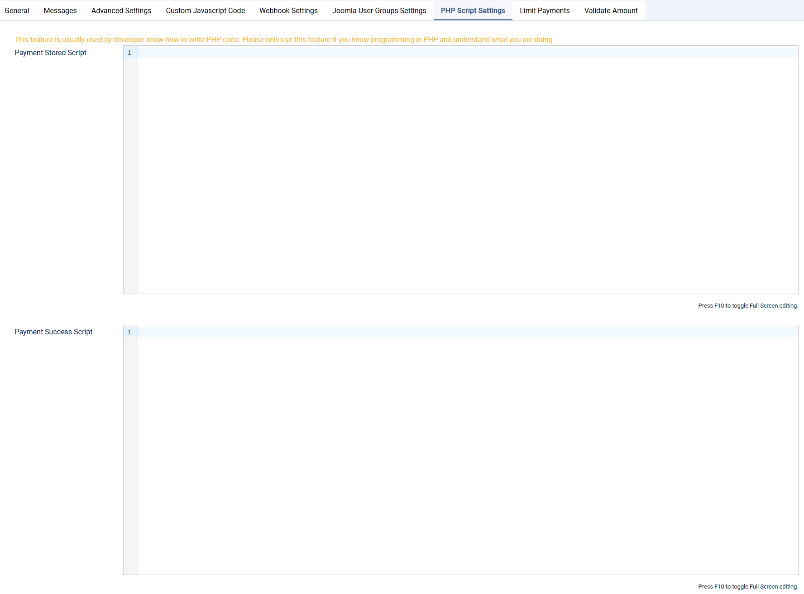

The **PHP Script** plugin allows you to execute custom PHP code at specific points in the payment process. This powerful developer tool enables advanced customization, integration with external systems, custom business logic, and workflows that aren't available through standard plugin functionality. This plugin provides maximum flexibility for developers to extend Payment Form capabilities without modifying core files.

**Warning:** This plugin requires PHP programming knowledge and should only be used by experienced developers. Errors in custom scripts can prevent payment processing or cause system issues.

Go to System -> Plugins, find and enable plugin **Payment Form - PHP Script** if you want to use this feature. Now, when you add/edit a form, you will see **PHP Script Settings** allows you to execute the script you want for each form.

- **Payment Store Script**: PHP code executed when payment record is first created (offline payments) or stored. Runs during `onAfterStorePayment` event
- **Payment Active Script**: PHP code executed when payment becomes successful (online payment completion or offline payment activation). Runs during `onAfterPaymentSuccess` event.

## How It Works

### Payment Store Script Execution

1. **Trigger Point** - Offline payment record is saved to database
2. **Script Execution** - Payment Store Script code runs
3. **Available Data** - Access to payment record and form field data
4. **Use Cases** - Logging, preliminary validations, staging data

### Payment Active Script Execution

1. **Trigger Point** - Online payment successfully completed OR offline payment activated by admin
2. **Script Execution** - Payment Active Script code runs
3. **Available Data** - Full payment record, form fields, payment status
4. **Use Cases** - Final processing, integrations, notifications, data updates

### Available Variables in Scripts

Both scripts have access to:

- `$row` - Payment record object with all payment data
- `$row->form_id` - ID of the form
- `$row->id` - Payment record ID
- `$row->payment_amount` - Payment amount
- `$row->user_id` - User ID (if logged in)
- Form field data accessible via field mapping
- Joomla framework classes and functions
